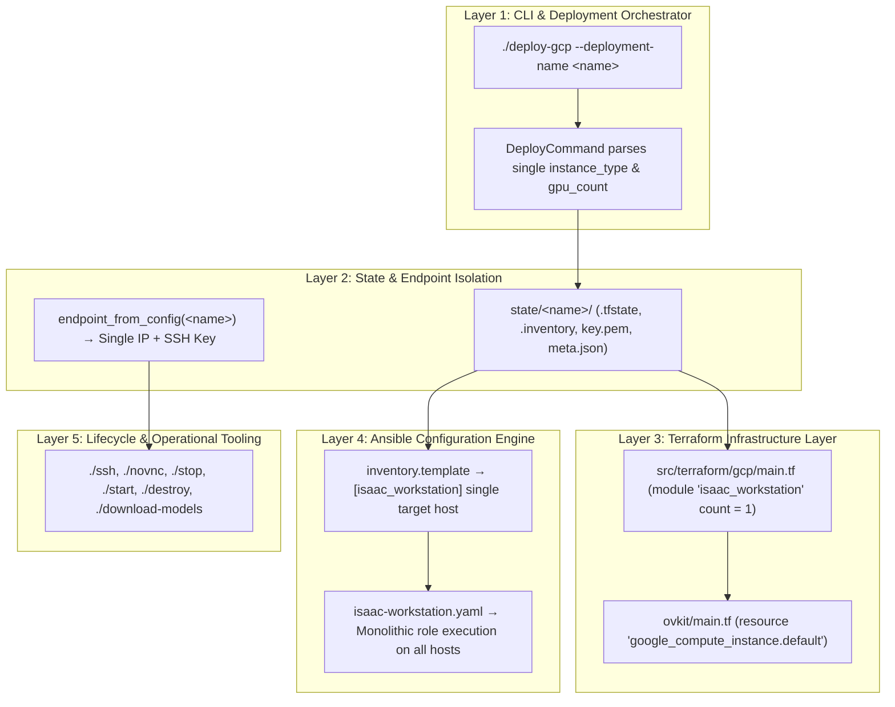
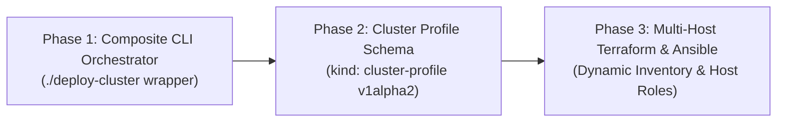

# Architectural Limitations: Single-Node Deployment Coupling & Multi-Instance Cluster Constraints

> **Date**: 2026-10-29  
> **Status**: Discovered & Documented  
> **Scope**: CLI (`deploy_command.py`, `deployer.py`), Terraform Engine (`src/terraform/gcp/main.tf`, `ovkit/main.tf`, AWS/Azure equivalents), Ansible Engine (`isaac-workstation.yaml`, `inventory.template`), State Storage (`state/<deployment_name>/`), Lifecycle Operators (`ssh`, `stop`, `start`, `destroy`, `novnc`, `download-models`).

---

## 1. Executive Summary

During the implementation of large-scale physical AI workloads—specifically pairing a simulation/evaluation runner (`g4-standard-48`) with a massive 8x GPU foundation model host (`g4-standard-384`) capable of running the 321B parameter **GLM-5.3-Flash** in VRAM—we identified a foundational architectural constraint:

**Isaac Automator is strictly architected around a 1-to-1 paradigm: One Deployment Name = Exactly One Cloud Virtual Machine.**

A single deployment profile cannot provision, configure, or manage heterogeneous multi-instance topologies (e.g., launching an 8x GPU model host alongside a 1x GPU physics runner in one command). 

While declarative profiles (`configs/profiles/*.yaml`) can document cluster topology, deploying multiple instances requires running separate deployment commands with independent deployment names. This document analyzes the root causes across all five system layers, evaluates the operational and cost implications, and defines the roadmap for native multi-node cluster orchestration.

---

## 2. Exhaustive Layer-by-Layer Architectural Audit



---

### Layer 1: CLI & Argument Parsing ([`src/python/deploy_command.py`](file:///workspaces/IsaacAutomator/src/python/deploy_command.py) & [`deployer.py`](file:///workspaces/IsaacAutomator/src/python/deployer.py))

| Component | Code Location | Constraint & Consequence |
| :--- | :--- | :--- |
| **Singular Name Argument** | `deploy_command.py:840` | Click CLI declares `--deployment-name` as a scalar string. Every internal lookup maps this name to a single directory in `state/<deployment_name>`. |
| **Scalar Hardware Parameters** | `deploy_command.py:91-95` | Profile evaluation extracts scalar values: `gpu_model` and `gpu_count`. There is no schema construct to emit a list or dictionary of heterogeneous node configurations. |
| **Sequential Execution Assumption** | `deployer.py:1250-1320` | `Deployer.run()` executes a linear pipeline: Terraform Init & Apply $\rightarrow$ Wait for SSH Connection $\rightarrow$ Ansible Playbook Execution. It assumes a single host target. |

---

### Layer 2: Terraform Module Singleton ([`src/terraform/gcp/main.tf`](file:///workspaces/IsaacAutomator/src/terraform/gcp/main.tf) & [`ovkit/main.tf`](file:///workspaces/IsaacAutomator/src/terraform/gcp/ovkit/main.tf))

| Component | Code Location | Constraint & Consequence |
| :--- | :--- | :--- |
| **Module Cardinality** | `main.tf:31-34` | `module "isaac_workstation"` is guarded by `count = var.isaac_workstation_enabled ? 1 : 0`. The root module only ever creates 0 or 1 instances of the workstation module. |
| **Singleton Compute Instance** | `ovkit/main.tf:50-53` | `resource "google_compute_instance" "default"` has no `count` or `for_each` loop. It accepts exactly one `var.instance_type`, one `var.boot_disk_size_gb`, and one `var.gpu_count`. |
| **Scalar Output Contract** | `ovkit/outputs.tf:1-15` | The module exports singular outputs: `isaac_workstation_public_ip`, `isaac_workstation_private_ip`, and `isaac_workstation_vm_id`. Downstream python scripts rely strictly on these scalar keys. |
| **AWS & Azure Parity** | `src/terraform/aws/` & `azure/` | AWS (`isaac-workstation/main.tf`) and Azure follow the identical singleton pattern (`resource "aws_instance" "default"`). |

---

### Layer 3: Ansible Inventory & Role Specialization ([`src/ansible/inventory.template`](file:///workspaces/IsaacAutomator/src/ansible/inventory.template) & [`isaac-workstation.yaml`](file:///workspaces/IsaacAutomator/src/ansible/isaac-workstation.yaml))

| Component | Code Location | Constraint & Consequence |
| :--- | :--- | :--- |
| **Single-Host Group** | `inventory.template:37-41` | Inventory template defines `[targets:children] -> isaac_workstation` and `[isaac_workstation] -> {isaac_workstation_ip}`. It cannot register multiple IPs under distinct functional host groups. |
| **Homogeneous Role Chain** | `isaac-workstation.yaml:48-50` | The playbook executes `roles: [isaac-workstation]` against all hosts in `isaac_workstation`. It has no conditional logic to install GUI/Sim on Node A while installing headless vLLM/MoE on Node B. |
| **Inventory Writer** | `deployer.py:1025-1048` | `Deployer._generate_inventory()` substitutes `{isaac_workstation_ip}` from the single IP in Terraform output. Multiple nodes would require dynamic inventory generation. |

---

### Layer 4: State Directory & Endpoint Identity ([`state/<name>/`](file:///workspaces/IsaacAutomator/src/python/file_transfer.py))

| Component | Code Location | Constraint & Consequence |
| :--- | :--- | :--- |
| **Directory Isolation** | `file_transfer.py:40-60` | `endpoint_from_config(deployment_name)` reads `state/<deployment_name>/.inventory` and `key.pem` to return a single `SSHEndpoint(ip, user, port, key)`. |
| **Ambiguous Target Resolution** | All tooling | If `<deployment_name>` represented a cluster of 2+ VMs, commands like `./ssh <name>`, `./novnc <name>`, or `./open-browser <name>` would face ambiguous routing. |
| **Lock Collision** | `sync_supervisor.py` | Local file locks (`state/<name>/.lock`) serialize operations per deployment name, preventing simultaneous multi-node synchronization under a shared name. |

---

### Layer 5: Operational Commands & Cost Isolation

| Command | Current Behavior (1 VM per Deployment) | Failure Mode if Multi-Node were Bundled |
| :--- | :--- | :--- |
| **`./stop <name>`** | Calls `gcloud compute instances stop <vm_id>`. | Would stop **all** nodes in the cluster simultaneously, preventing partial scale-down. |
| **`./start <name>`** | Calls `gcloud compute instances start <vm_id>`. | Would boot both instances, incurring unintended billing on idle nodes. |
| **`./destroy <name>`** | Runs `terraform destroy` in `state/<name>`. | Destroys the entire cluster; cannot tear down the expensive model server while keeping the runner. |
| **`./download-models`** | Connects to the single IP to hydrate weights. | Would not know which node possesses the attached high-speed models volume. |

---

## 3. Case Study: GLM-5.3-Flash + IsaacLab-Arena Benchmark

The tension between single-node architecture and production robotics workloads is best illustrated by our large-scale setup:

```
Workload Requirement:
  - Physics & Simulation: Isaac Sim 6.0.1 + Isaac Lab + IsaacLab-Arena (requires Vulkan GUI, Display :0, 1x GPU)
  - Cognitive Foundation MoE: GLM-5.3-Flash (321B MoE, 190 GB safetensors, requires 8x GPUs with TP=8, 768 GB VRAM)
```

### Why a Single Instance Cannot Satisfy This Efficiently

1. **If Run on a Single 1x GPU Node (`g4-standard-48`)**:
   - The 190 GB GLM-5.3-Flash weights cannot fit in the 96 GB VRAM.
   - Weights must be offloaded to CPU host memory or heavily quantized (INT4), reducing inference throughput from ~80 tok/s to ~2 tok/s—breaking real-time closed-loop robot control.

2. **If Run on a Single 8x GPU Node (`g4-standard-384`)**:
   - Both workloads can run, but costs **$18.00 – $36.00 / hour**.
   - Developers writing code, debugging URDFs, or inspecting scene USDs pay full 8-GPU burn rate even when no model inference is occurring.

3. **Optimal Dual-Node Setup (Current Recommended Pattern)**:
   - **Node 1: Simulation Runner (`scale-runner-48`)**: 1x RTX PRO 6000, 48 vCPU, 192 GB RAM (**~$2.25/hr**).
   - **Node 2: Model Host (`scale-host-384`)**: 8x RTX PRO 6000, 384 vCPU, 1.44 TB RAM (**~$18.00/hr**).
   - **Operational Advantage**: The developer can `./stop scale-host-384` when inference is idle, saving ~$15.75/hr while keeping the simulation environment running.

---

## 4. Current Workaround: Profile Topology Mapping

To bridge this architectural gap without destabilizing existing Terraform and Ansible modules, we introduced the **Dual-Profile Deployment Pattern** unified under [`configs/profiles/large-scale-studio-enterprise.yaml`](file:///workspaces/IsaacAutomator/configs/profiles/large-scale-studio-enterprise.yaml):

1. **The profile defines the 8x GPU Host by default**:
   ```bash
   ./deploy-gcp --deployment-name scale-host-384 --profile large-scale-studio-enterprise --existing replace
   ```
2. **The runner is deployed from the same profile using CLI overrides**:
   ```bash
   ./deploy-gcp --deployment-name scale-runner-48 --profile large-scale-studio-enterprise \
     --instance-type g4-standard-48 --isaac-workstation-gpu-count 1 --existing replace
   ```
3. **Both VMs share the same VPC subnet (`10.10.4.0/24`)**:
   The runner queries GLM-5.3-Flash at `http://scale-host-384.internal:8000/v1` over internal Google Cloud networking at **$0.00 egress cost** and **< 0.8ms network latency**.

---

## 5. Target Architecture: Roadmap for Native Multi-Node Clusters

To support native multi-instance deployments in future versions, Isaac Automator should implement the following progressive roadmap:



### Phase 1: Composite CLI Orchestrator (`./deploy-cluster`)
* Implement a lightweight Python wrapper that reads a cluster definition in the profile.
* Deploys `<cluster-name>-host` and `<cluster-name>-runner` sequentially as two isolated deployment directories.
* Preserves independent `./stop` and `./start` lifecycle control and dedicated `./ssh` endpoints.

### Phase 2: Cluster Profile Schema (`schema_version: v1alpha2`)
* Introduce `kind: cluster-profile` supporting an `instances:` mapping:
  ```yaml
  schema_version: "v1alpha2"
  kind: "cluster-profile"
  cluster_name: "robotics-eval-studio"
  nodes:
    runner:
      machine_type: "g4-standard-48"
      gpu_count: 1
      roles: ["simulation", "desktop"]
    host:
      machine_type: "g4-standard-384"
      gpu_count: 8
      roles: ["model_inference"]
  ```

### Phase 3: Decoupled Multi-Host Terraform & Dynamic Inventory
* Refactor `src/terraform/gcp/ovkit/main.tf` to use `for_each` over the node map.
* Emit a structured JSON output of all instances with internal IPs and public IPs.
* Generate an Ansible inventory with distinct child groups:
  ```ini
  [simulation_nodes]
  scale-runner-48-vm ansible_host=...

  [model_hosts]
  scale-host-384-vm ansible_host=...
  ```
* Allow Ansible playbooks to selectively apply roles (`role: remote-desktop` only on simulation nodes; `role: model-storage` and vLLM service only on model hosts).

---

## 6. Summary Comparison Matrix

| Capability | Current State (`v1alpha1`) | Composite Workaround | Target State (`v1alpha2`) |
| :--- | :--- | :--- | :--- |
| **VMs per Deployment** | 1 | 2 (Separate state folders) | N (Unified cluster state) |
| **Profile Schema** | Single `workstation` block | Topology blueprint in metadata | Native `nodes` mapping |
| **Deploy Command** | 2 separate `./deploy-gcp` commands | 1 `./deploy-cluster` script | 1 `./deploy-gcp` command |
| **Independent Start / Stop** | ✅ Full control per VM | ✅ Full control per VM | ✅ Selective: `./stop <cluster> --node host` |
| **VPC Interconnect** | ✅ Shared `10.10.4.0/24` subnet | ✅ Shared `10.10.4.0/24` subnet | ✅ Automated internal DNS resolution |
| **Ansible Specialization** | ❌ Monolithic run | ❌ Monolithic run per node | ✅ Tagged host group roles |
