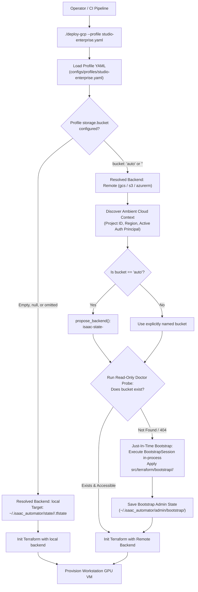

# Automated Remote Terraform State Provisioning Plan

**Status:** Proposed Architecture & Implementation Plan  
**Target Subsystem:** Profile Parser (`src/python/backend_selection.py`), Deployer Controller (`src/python/deployer.py`), CLI Runner (`src/python/deploy_command.py`), and Bootstrap Engine (`src/python/backend_bootstrap.py`)  
**Target Clouds:** GCP (GCS), AWS (S3), Azure (Blob Storage)

---

## 1. Executive Summary & Goal

Isaac Automator provides a production-hardened Terraform module (`src/terraform/bootstrap/<cloud>/main.tf`) and CLI engine (`./state-backend bootstrap`) that provisions secure remote state storage with object versioning, public access prevention, soft-delete protection, and native object locking.

However, the current workflow requires the operator to execute a manual 3-step ceremony:
1. Run `./state-backend propose` to generate a bucket name.
2. Manually copy-paste the resulting YAML into a separate config file (`configs/state-backends/gcs.yaml`).
3. Manually execute `./state-backend bootstrap` with extensive flags before deploying a workstation.

**The Goal:** Make remote Terraform state provisioning **entirely automated, native, and user-friendly**. A user simply declares their storage intent in their cloud profile (e.g. `configs/profiles/studio-enterprise.yaml`), runs `./deploy-<cloud>`, and Isaac Automator handles preflight inspection, just-in-time bootstrap provisioning, and Terraform initialization automatically.

---

## 2. Core Architectural Invariant: The "Bucket Option" Gate

Remote state is **strictly opt-in** governed by the profile's bucket configuration:

> **Rule:** If the bucket option in the profile is left empty, `null`, or omitted, remote state is **NOT** used. Isaac Automator defaults to local state without making any network calls to cloud storage APIs.

| Profile Configuration | Effective Backend | Runtime Behavior |
| :--- | :--- | :--- |
| **`bucket: ""`** (or `null` / omitted) | **`local`** | **Strict Local State.** No remote bucket is inspected, required, or created. State is stored locally at `~/.isaac_automator/state/<deployment>/.tfstate`. Zero cloud storage billing. |
| **`bucket: "auto"`** | **Remote (`gcs` / `s3` / `azurerm`)** | **Automated Remote State.** Automator deterministically generates a unique bucket name (`isaac-state-<hash>`), checks cloud existence, auto-provisions if missing, and streams state remotely. |
| **`bucket: "<custom-name>"`** | **Remote (`gcs` / `s3` / `azurerm`)** | **Named Remote State.** Automator targets the user's specific bucket name, checks cloud existence, auto-provisions if missing, and streams state remotely. |

---

## 3. High-Level Architecture & Lifecycle Flow



---

## 4. Workstreams & Implementation Plan

### Milestone 1: Profile Schema & Backend Selection Gate
* **Files**: `src/python/backend_selection.py`, `src/python/config.py`
* **Changes**:
  * Normalize the `storage` and `terraform_state` profile blocks:
    * If `bucket` is empty string (`""`), `null`, or omitted, resolve `state_backend = "local"`.
    * If `bucket == "auto"`, mark backend as remote with pending proposal resolution.
    * If `bucket` is a non-empty string, mark backend as remote with explicit destination.
  * Update `BackendSpec` validation to accept `auto` as a valid transitional placeholder before proposal synthesis.

### Milestone 2: Ambient Cloud Context Resolver
* **Files**: `src/python/backend_controller.py`, `src/python/gcp.py`
* **Changes**:
  * Create `resolve_cloud_context(cloud, project=None, region=None)`:
    * **GCP**:
      * `project`: Resolve from `--project` flag, `CLOUDSDK_CORE_PROJECT` environment variable, or `gcloud config get-value project`.
      * `region`: Resolve from `--region`, truncate from `--zone` (e.g. `us-central1-a` $\rightarrow$ `us-central1`), or fallback to `us-central1`.
      * `controller_principal`: Resolve active identity via `gcloud config get-value account` (formatted as `user:<email>` or `serviceAccount:<email>`).
    * **AWS**:
      * `owner_account_id`: Resolve via `aws sts get-caller-identity --query Account`.
      * `region`: Resolve from `AWS_REGION` or `aws configure get region`.
      * `controller_principal`: Resolve caller role/user ARN.
    * **Azure**:
      * `subscription_id` / `tenant_id`: Resolve via `az account show`.
      * `controller_principal`: Resolve caller Service Principal or User Object ID.

### Milestone 3: Zero-Touch Just-In-Time Bootstrap (`ensure_backend_storage`)
* **Files**: `src/python/backend_controller.py`, `src/python/backend_bootstrap.py`
* **Changes**:
  * Implement `ensure_backend_storage(backend_spec, *, auto_bootstrap=False, non_interactive=False)`:
    1. **Preflight Probe**: Run read-only `doctor(spec, acknowledge_reads=True)` or bounded absence check (`_assert_absent()`).
    2. **Healthy / Existing Destination**: Return immediately and allow Terraform to initialize.
    3. **Missing Destination (`not-found`)**:
       * If interactive and not `--auto-bootstrap`: Prompt user for confirmation.
       * If headless / non-interactive / `--auto-bootstrap`: Proceed automatically.
       * Instantiate `BootstrapSession` in-process with the resolved admin state root (`~/.isaac_automator/admin/bootstrap/`).
       * Execute `plan()` and `apply(plan, acknowledge_creation=True)` using the hardened module (`src/terraform/bootstrap/<cloud>/main.tf`).
       * Verify bucket readiness and hand off to workstation Terraform.

### Milestone 4: Deployer & CLI Pipeline Integration
* **Files**: `src/python/deploy_command.py`, `src/python/deployer.py`
* **Changes**:
  * Update `DeployCommand.parse_args`:
    * Add `--auto-bootstrap` / `--no-auto-bootstrap` CLI flags (defaults to `True` for automated non-interactive deployments).
    * Automatically extract `storage.backend` and `storage.bucket` from the profile.
  * Update `Deployer.validate_configuration()`:
    * If `state_backend == 'local'`: Bypass all remote bootstrap logic entirely.
    * If remote backend is requested: Invoke `ensure_backend_storage()` prior to executing `initialize_terraform()` or `run_terraform()`.
    * Pin the effective remote identity in the deployment's `meta.json`.

### Milestone 5: Safety Invariants & Teardown Isolation
* **Separation of Admin vs. Workstation Lifecycles**:
  * The state bucket bootstrap state is recorded in `~/.isaac_automator/admin/bootstrap/` (an independent root, outside workstation staging).
  * Workstation teardown (`./destroy <deployment_name> --yes`) destroys only the workstation VM, disks, firewall rules, and local metadata. It **strictly never destroys the remote state bucket**.
  * The bootstrap Terraform module enforces `prevent_destroy = true` on the storage bucket.
* **Fail-Closed Lineage & Locking**:
  * Once provisioned on GCS, output inspection, start/stop, repair, and destroy operations communicate solely with GCS.
  * Split-brain fallback to local snapshots upon cloud authentication failure remains strictly forbidden.

---

## 5. Profile Configuration Reference

### Case A: User Wants Local State (Default / Zero Cloud Cost)
Leave `bucket` empty:
```yaml
schema_version: "v1alpha1"
profile_name: "studio-enterprise"
cloud: "gcp"

storage:
  backend: "local"
  bucket: ""       # Empty = Local state only (~/.isaac_automator/state/<name>/.tfstate)
```

### Case B: User Wants Remote Cloud State (Auto-Named & Auto-Bootstrapped)
Set `bucket: "auto"`:
```yaml
schema_version: "v1alpha1"
profile_name: "studio-enterprise"
cloud: "gcp"

storage:
  backend: "gcs"
  bucket: "auto"   # Automator deterministically creates & manages isaac-state-<hash>
```

### Case C: User Wants Remote Cloud State (Custom Bucket Name)
Specify the bucket name:
```yaml
schema_version: "v1alpha1"
profile_name: "studio-enterprise"
cloud: "gcp"

storage:
  backend: "gcs"
  bucket: "my-studio-terraform-state" # Automator checks and provisions this exact bucket
```

---

## 6. Verification & Acceptance Criteria

1. **Local Opt-Out Verification**:
   * Deploying a profile with `bucket: ""` must execute with `state_backend = "local"`.
   * Unit tests verify zero calls to `gcloud storage`, `aws s3api`, or `az storage`.
2. **Auto-Bootstrap JIT Verification**:
   * Deploying a profile with `bucket: "auto"` against an unprovisioned project creates the GCS bucket with uniform access, object versioning, and soft-delete retention.
   * Workstation Terraform successfully initializes against the new bucket.
3. **Existing Bucket Adoption Verification**:
   * Subsequent deployments against the same bucket detect its existence during preflight and skip bootstrap without error.
4. **Teardown Isolation Verification**:
   * Running `./destroy <name> --yes` completely removes the workstation compute resources while the GCS state bucket and its object versions remain 100% intact.
