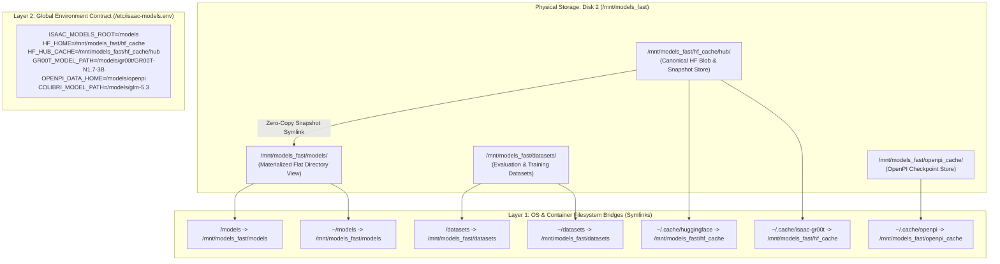
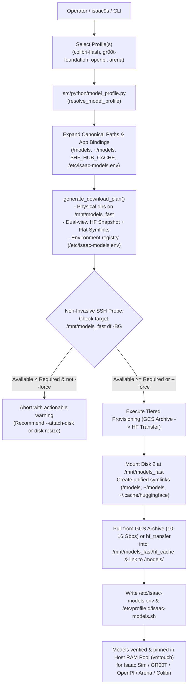

# Declarative Model Profiles & High-Speed Provisioning Plan

**Status:** Implementation In Progress (Phases 1–3 Complete; Phases 4–5 Planned)  
**Target Subsystems:** Model Configuration Layer (`configs/models/`), Model Profile Parser (`src/python/model_profile.py`), Standalone Downloader (`download-models`), and isaac9s Cockpit (`src/tui/screens/models.py`)  
**Target Environments:** Bare-Metal Robotics Workstations, Cloud Workstations (GCP, AWS, Azure), High-Speed NVMe Storage Arrays

---

## 1. Executive Summary & Architectural Motivation

Isaac Automator provisions remote GPU workstations for Isaac Sim, Isaac Lab, and Physical AI. Prior to this implementation, the repository decoupled:
1. **Cloud Infrastructure & Networking** in [`configs/profiles/`](../../../configs/profiles/) (VPC, GCP/AWS machine shape, GPU type, firewall, security tier).
2. **Software Stack & Desktop OS** in [`configs/workstations/`](../../../configs/workstations/) (Isaac Sim 6.0.1, Isaac Lab v3, KasmVNC, devtools).

### The Missing Layer: Model Weights & Checkpoints
Physical AI and robotics foundation models (e.g. **Colibrì GLM-5.3 MoE**, **NVIDIA Isaac-GR00T**, **LeRobot**, **Cosmos**) range from 10 GB to 400+ GB. 

Coupling model weights directly to either infrastructure or software profiles caused critical problems:
- **Lifecycle Mismatch:** Workstation OS and simulator binaries are provisioned once and change infrequently. Model checkpoints change frequently across experiments and benchmarks.
- **Extreme Disk & I/O Requirements:** MoE models (such as Colibrì's 744B flagship with 141 shards or 321B flash with 62 shards) require gigabytes-per-second sequential read speeds directly into GPU VRAM. They often live on dedicated high-speed NVMe drives (e.g. `/mnt/models_fast/` on `/dev/nvme1n1p1`).
- **Legacy Limitations:** The legacy Ansible `huggingface-artifacts` role was rigid: it enforced 40-character commit hashes, used a slow Python loop, and hardcoded staging to a hidden cache without configurable application paths or symlinks.

**The Solution:** Establish the **Triad of Separation of Concerns**:
```
configs/
├── profiles/      # Layer 1: Infrastructure & Cloud (where it runs)
├── workstations/  # Layer 2: Simulators, OS, & Devtools (what tools run)
└── models/        # Layer 3: Model Weights & Checkpoints (what weights it loads)
```

---

## 2. Storage Topology: Bare-Metal Host vs. Cloud Workstation

### 2.1 Host Bare-Metal Architecture
The bare-metal host uses hardware-accelerated dual NVMe storage to achieve the read throughput needed for dynamic MoE expert streaming:
- **Primary OS Disk (`/dev/nvme0n1`):** System, workspace, and tooling.
- **Secondary Fast NVMe (`/dev/nvme1n1p1`):** Mounted at `/mnt/models_fast/` (symlinked as `/mnt/nvme1`).
  - Model weights directory: `/mnt/models_fast/models/`
  - GLM-5.3 (744B Flagship, ~419 GB, 141 shards): `/mnt/models_fast/models/glm-5.3/`
  - GLM-5.3-Flash (321B Multimodal, ~182 GB, 62 shards): `/mnt/models_fast/models/glm-5.3-flash/`
  - Local cache & archive: `/mnt/models_fast/hf_cache/`, `/mnt/models_fast/archive/models/`
- **Application Mounts & Symlinks:**
  - Container mount: `/home/tarfy/models` mounted to `/models` inside containers.
  - Dual-NVMe streaming mirror: `/home/tarfy/models_mirror`.

### 2.2 Cloud Workstation Reality (`studio-workstation` on GCP)
- Currently provisioned with a single 255 GB boot disk (`/dev/nvme0n1p1`), with **129 GB free**.
- Downloading 182 GB (`GLM-5.3-Flash`) or 419 GB (`GLM-5.3`) directly onto root will exhaust disk space.
- Cloud solution:
  - **Option A (Attached High-Speed Volume):** Create and attach a 500 GB – 1 TB GCP `pd-ssd` or `Hyperdisk` formatted and mounted at `/mnt/models_fast`, with symlink `/models -> /mnt/models_fast/models`.
  - **Option B (Boot Disk Expansion):** Online resize of the GCP boot disk to 500 GB+ and creating `/mnt/models_fast/models` on root.
  - **Option C (Pruned / Quantized Variants):** Deploying sub-100 GB quantized weights directly into the existing 129 GB free space.

### 2.3 The Unified Logical Presentation Contract
Regardless of physical hardware (multi-NVMe bare-metal vs attached cloud PD), applications and containers always access models via the **logical contract**:
- Primary: `/models/glm-5.3` and `/models/glm-5.3-flash`
- Compatibility symlinks: `/mnt/models_fast/models/` and `~/models/`

---

## 3. Cloud Storage Performance, IOPS, & MoE Streaming Bottlenecks

A common pitfall in AI cloud deployments is treating cloud virtual disks like physical bare-metal NVMe drives. For conventional workloads or small models that fit entirely into GPU VRAM (e.g. Isaac-GR00T, LeRobot), disk speed only impacts initial boot/cold-start load times. However, for **Colibrì Dynamic MoE Expert Streaming**, storage throughput is the **direct runtime bottleneck for token generation**.

### 3.1 The MoE Dynamic Paging Mechanism
During token generation, the MoE router dynamically selects top-k active experts per layer. If weights are not resident in VRAM, the engine must stream safetensors shards from storage into GPU memory in real-time. If the storage subsystem cannot deliver gigabytes-per-second sequential throughput and low-latency random IOPS, the GPU compute engines starve, causing continuous disk-bound page faults.

### 3.2 Throughput, IOPS, & Token Latency Comparison

| Storage Tier / Environment | Sequential Read Throughput | Random Read IOPS | Colibrì MoE Generation Latency | Real-World Viability |
| :--- | :--- | :--- | :--- | :--- |
| **Bare-Metal Host**<br>(Dedicated PCIe 4.0/5.0 NVMe `/dev/nvme1n1`) | **7,000 – 14,000 MB/s**<br>(7 – 14 GB/s) | **800,000 – 1,500,000** | **10 – 25+ tok/s**<br>(Smooth interactive chat) | **Optimal**<br>(Production reference) |
| **Cloud Standard Disk**<br>(GCP `pd-balanced` / AWS `gp3` baseline) | **150 – 250 MB/s** | **3,000 – 6,000** | **0.1 – 0.5 tok/s**<br>(Severe stall; seconds per token) | **Unusable**<br>(Do not run MoE streaming) |
| **GCP Hyperdisk Throughput**<br>(Provisioned to `g4-standard-48` ceiling) | **1,600 MB/s**<br>(1.6 GB/s) | **75,000** | **2 – 5 tok/s**<br>(Tolerable, but sluggish) | **Marginal**<br>(Requires max provisioned PD) |
| **Cloud Local NVMe SSD**<br>(GCP Local SSD / AWS Instance Store) | **4,000 – 9,600 MB/s**<br>(4 – 9.6 GB/s) | **660,000 – 2,400,000** | **10 – 25 tok/s**<br>(Matches bare-metal NVMe) | **Optimal for Cloud**<br>(Requires local NVMe attachment) |
| **Host System RAM Offload**<br>(`/dev/shm` / tmpfs over PCIe 5.0) | **28,500 – 60,000 MB/s**<br>(Verified 28.5 GB/s on VM) | **Millions** | **30 – 60+ tok/s**<br>(Blazing fast throughput) | **Best for Models ≤ Host RAM**<br>(Ideal for GLM-5.3-Flash) |

### 3.3 Cloud Hypervisor Limits (`g4-standard-48` and AWS `g5`)

1. **Google Cloud `g4-standard-48` Limits:**
   - **Machine Profile:** 48 vCPUs, 192 GB DDR5 RAM, 1x NVIDIA RTX PRO 6000 Blackwell (96 GB VRAM, `sm_120`).
   - **Hypervisor Block Storage Cap:** The VM enforces an aggregate limit of **1,600 MiB/s (1.6 GB/s) and 75,000 IOPS** across all network persistent disks (including Hyperdisk). Any provisioned performance above this ceiling is throttled by the hypervisor.
   - **Default Boot Disk Reality:** The provisioned 255 GB `pd-balanced` boot disk has an effective throughput of ~200 MB/s, which will choke MoE streaming.
2. **AWS EC2 Limits (`g5.12xlarge` / `g4dn`):**
   - Standard EBS `gp3` volumes default to 125 MB/s and 3,000 IOPS.
   - Network EBS latency (1–2 ms queue delay per request) induces high tail latency on fine-grained shard reads, even when provisioned with higher burst bandwidth.

### 3.4 Production Patterns Used by AI Infrastructure Teams

Based on industry engineering practices (vLLM, DeepSpeed-MoE, Apple LLM in a Flash research):

- **Pattern 1: Ephemeral Local NVMe SSDs (Instance Store):**
  - Teams bypass network block storage entirely by attaching GCP Local SSDs (375 GB NVMe blocks physically co-located in the hypervisor chassis) or AWS Instance Stores.
  - A 2-disk RAID 0 stripe across 2x 375 GB Local SSDs yields 750 GB of storage with **6+ GB/s sequential reads and 1,000,000+ IOPS**, matching physical workstation performance.
  - *Lifecycle handling:* Local SSDs are ephemeral. Checkpoints are archived in GCS/S3 and re-synced to `/mnt/models_fast` upon VM start via background systemd tasks or Automator data transfer.
- **Pattern 2: Host Memory Offloading (`/dev/shm` / RAM Disk):**
  - Because `g4-standard-48` has **192 GB of high-speed host RAM**, models like GLM-5.3-Flash (182 GB) can be mapped into host memory.
  - Live empirical testing on `studio-workstation` verified **28.5 GB/s memory-read bandwidth**. Streaming active weights from host RAM to GPU VRAM over the PCIe 5.0 bus is **2x–4x faster than even physical NVMe**.
- **Pattern 3: Kernel Asynchronous I/O (`io_uring` + `O_DIRECT`):**
  - Advanced inference engines bypass synchronous `read()` calls using Linux `io_uring` with kernel polling.
  - Speculative prefetching predicts the top candidate experts for the next token layer and pages them asynchronously while the current token's attention heads compute on the GPU.

### 3.5 The Highlighted Production Hybrid Strategy

To achieve the best balance of cost efficiency, cold-start latency, and runtime streaming bandwidth across large model catalogs, Isaac Automator adopts the **Three-Tier Hybrid Architecture**:

```
┌─────────────────────────────────────────────────────────────────────────────┐
│ 1. PRIMARY MASTER ARCHIVE (Cloud Object Storage - Durability Tier)          │
│    • Private GCS Bucket: gs://<project>-models/glm-5.3-flash/               │
│    • Cost: ~$3.64 / month for 182 GB (~$0.02/GB-month)                      │
│    • Invariant: Survives VM destruction, available to any node or fleet     │
└──────────────────────────────────────┬──────────────────────────────────────┘
                                       │
                                       │ Fast GCP internal network pull
                                       │ (~2.5 mins @ 10-16 Gbps)
                                       ▼
┌─────────────────────────────────────────────────────────────────────────────┐
│ 2. CLOUD VM PERSISTENT DISK (Attached Secondary Volume - Daily Working Tier)│
│    • Dedicated secondary Persistent Disk mounted at /models                 │
│    • Sizing: Calculated dynamically based on project scope & models catalog │
│      (e.g. 500 GB for Flash, 1-2 TB for multi-model suites)                 │
│    • Daily Lifecycle: Preserved across ./stop and ./start                   │
│    • Startup: 0-second cold-start delay for daily engineering sessions      │
└──────────────────────────────────────┬──────────────────────────────────────┘
                                       │
                                       │ Memory warmup / Page cache pin
                                       │ (vmtouch / readahead @ ~500 MB/s)
                                       ▼
┌─────────────────────────────────────────────────────────────────────────────┐
│ 3. RUNTIME MEMORY TIER (Host System RAM - Dynamic Streaming Tier)           │
│    • Host RAM pool (/dev/shm or tmpfs) on g4-standard-48 (192 GB DDR5 RAM) │
│    • Verified Bandwidth: 28.5 GB/s streaming into GPU VRAM over PCIe 5.0    │
│    • Performance: Zero disk I/O bottlenecks; 30-60+ tokens/sec decode       │
│    • Execution: NVIDIA RTX PRO 6000 Blackwell (96 GB VRAM, sm_120)          │
└─────────────────────────────────────────────────────────────────────────────┘
```

#### Sizing and Dynamic Scope Calculation
The secondary persistent disk must not be statically fixed; its capacity must be calculated dynamically based on:
1. **Model Catalog Sum:** Total uncompressed checkpoint footprint declared across active model profiles (e.g., 182 GB for `colibri-flash` + 40 GB for `gr00t-foundation` = 222 GB + 25% safety margin = 300–500 GB PD).
2. **Multi-Model Concurrency:** When experimenting with multiple model variants (e.g. full 744B MoE + 321B Flash + LeRobot policies), the storage tier scales up to 1 TB or 2 TB attached storage.
3. **RAM Pool Allocation:** For models fitting within the instance RAM budget (like GLM-5.3-Flash at 182 GB on a 192 GB instance), the runtime loader pins weights directly into host memory via `vmtouch` or Linux page cache readahead, eliminating disk throughput caps during inference.

---

## 4. Declarative Schema Specification (`configs/models/*.yaml`)

Each model profile is a declarative YAML document adhering to `schema_version: v1`:

```yaml
schema_version: v1
model_profile_name: colibri-streaming
description: "Colibri Streaming MoE layout for dual-drive NVMe host or high-throughput cloud storage"

# Global defaults
defaults:
  provider: huggingface           # huggingface, modelscope, url, s3
  download_engine: hf_transfer    # hf_transfer (Rust fast transfer) or hf_cli
  auth_env: HF_TOKEN             # Target/host environment variable for authentication

# Storage topology configuration
storage:
  physical_dir: /mnt/models_fast/models
  logical_mounts:
    - target: /models
      link_to: /mnt/models_fast/models
    - target: ~/models
      link_to: /mnt/models_fast/models
    - target: /mnt/nvme1
      link_to: /mnt/models_fast

# Declared models and checkpoint shards
models:
  - name: glm-5.3-flash
    description: "321B MoE Multimodal (62 shards, ~182 GB)"
    repo_id: zai-org/GLM-5.3-Flash
    repo_type: model             # model or dataset
    revision: main               # branch, tag, or commit hash
    destination: /mnt/models_fast/models/glm-5.3-flash
    symlinks:
      - /models/glm-5.3-flash
      - /models/glm-5.3
    allow_patterns:
      - "*.safetensors"
      - "*.json"
      - "*.txt"
      - "tokenizer*"
    ignore_patterns:
      - "*.bin"
    min_disk_free_gb: 190
```

---

## 4.5 Master Model Zoo & Physical AI Models Catalog

The evaluation and simulation pipeline sweeps a structured **Master Model Zoo** across three functional tiers. All 17 models are codified as declarative YAML profiles in [`configs/models/`](../../../configs/models/):

### 1. Cognitive Specification Synthesizers (Spec LLMs on Port 8000 / GPU 0)
Generates finite relational scene graphs, SHACL constraints, and spatial factor coordinates:

| Model (`repo_id`) | Architecture | Serving Engine & Port | Functional Role | Min Disk |
| :--- | :--- | :--- | :--- | :--- |
| `Qwen/Qwen2.5-72B-Instruct-AWQ` | 72B Dense Transformer (AWQ) | vLLM (`arena-vllm-spec`, Port 8000) | Active Workstation Baseline Anchor (Dense instruction reasoning) | 42 GB |
| `Qwen/Qwen2.5-Coder-32B-Instruct-AWQ` | 32B Code-Specialized (AWQ) | vLLM (`arena-vllm-spec`, Port 8000) | Historical Control Baseline (Grammar & syntax control; 32k/131k YaRN) | 20 GB |
| `Qwen/QwQ-32B-AWQ` | 32B Reasoning CoT (AWQ) | vLLM (`arena-vllm-spec`, Port 8000) | Test-Time Spatial Deduction (Zero-shot analytical proof in `<think>`) | 20 GB |
| `deepseek-ai/DeepSeek-R1-Distill-Qwen-32B` | 32B Distilled RL CoT | vLLM (`arena-vllm-spec`, Port 8000) | Spatial CoT Reasoner (RL-distilled reasoning tokens) | 66 GB |
| `Qwen/Qwen3-32B-FP8` | 32B Dual-Mode Transformer | vLLM (`arena-vllm-spec`, Port 8000) | Next-Gen Dual-Mode CoT (Native thinking + structured YAML emission) | 35 GB |
| `Qwen/Qwen3-30B-A3B-FP8` | 30B MoE (3B active FP8) | vLLM (`arena-vllm-spec`, Port 8000) | High-Throughput MoE (Rapid sub-second Bayesian repair loops) | 32 GB |
| `Qwen/Qwen2.5-VL-72B-Instruct-AWQ` | 72B Omnimodal VLM | vLLM (`arena-vllm-spec`, Port 8000) | Unified Omnimodal Engine (Single-service spec generation + visual critique) | 46 GB |
| `zai-org/GLM-5.3` | 744B MoE (42B active, INT4 gs64) | Colibrì Engine (Vulkan DMA) | Frontier World Knowledge Ceiling (141 shards streamed from NVMe/RAM) | 440 GB |
| `zai-org/GLM-5.3-Flash` | 321B Multimodal MoE | Colibrì Engine (Vulkan DMA) | High-Capacity Multimodal MoE (62 shards, dual-role factor graph & visual critic) | 190 GB |

### 2. Visual Critics, World Models & Geometric Oracles (Port 8001 / 8002 / CPU)
Evaluates step-0 rendered camera viewports, dynamic physics, and motion manifolds:

| Model / Critic (`repo_id`) | Architecture | Serving Engine / Port | Functional Role | Min Disk |
| :--- | :--- | :--- | :--- | :--- |
| `nvidia/Cosmos-Reason2-2B` | 2B Physical AI World Model | vLLM (`arena-vllm-visual`, Port 8001) | Physical Dynamics Critic (V2) (Audits approach vectors & swept volume clearings) + GR00T VLM backbone | 8 GB |
| `Qwen/Qwen2.5-VL-7B-Instruct` | 7B Multimodal VLM | vLLM (`arena-vllm-visual`, Port 8001) | General Multimodal Scene Critic (V1) (2D scene visual verification) | 17 GB |
| `Qwen/Qwen3-VL-32B-Thinking` | 32B Visual CoT Critic | vLLM (`arena-vllm-visual`, Port 8001) | Visual Chain-of-Thought Critic (Step-0 viewport visual reasoning for Qwen3) | 66 GB |
| `depth-anything/DA3METRIC-LARGE` + `Ruicheng/moge-2-vitl` | Metric 3D Depth & Normal Estimation | In-Tree Daemon (Port 8002, GPU 0) | Dense Metric Depth & Normal Oracle (V3) (Verifies deck contact & normal alignment) | 6 GB |
| Deterministic Physical AI Oracle | Pure Python + Pixar USD `BBoxCache` | In-Tree CLI (`verify_articulated_spec.py`, CPU) | Exact Analytical Geometry (V0) (Zero-VRAM exact ground-truth collision check) | 0 GB |

### 3. Closed-Loop Foundation Robotics Policies (GPU 1)
Downstream policies evaluated across certified scene graphs for 10 seeds (20 s horizon) on Franka DROID:

| Policy Model (`repo_id`) | Architecture | Serving Container & Port | Execution Modality | Min Disk |
| :--- | :--- | :--- | :--- | :--- |
| `nvidia/GR00T-N1.7-3B` (Policy $\alpha$) | Flow-Matched Diffusion Transformer (DiT) | `gr00t-server` on Port 5556 (ZeroMQ) | 50 Hz continuous Cartesian velocity control | 15 GB |
| `physical-intelligence/pi05_droid_jointpos` (Policy $\beta$) | Autoregressive / Flow Hybrid Diffusion (`pi05_droid_jointpos`) | `openpi-server` on Port 8008 (WebSocket) | 50 Hz relative joint position control | 20 GB |
| `nvidia/GR00T-N1.6-DROID` | Flow-Matched DiT | `gr00t-server` on Port 5556 (ZeroMQ) | Historical baseline control | 15 GB |

### Implemented Declarative Profiles Catalog (`configs/models/*.yaml`)
1. **[`configs/models/complete-model-zoo.yaml`](../../../configs/models/complete-model-zoo.yaml)** — **Complete Master Model Zoo** (all 17 models across Roles 1, 2, and 3; total `min_disk_free_gb: 1038 GB` $\rightarrow$ dynamically provisions a **1,300 GB** `hyperdisk-balanced` secondary disk with 25% safety buffer).
2. **[`configs/models/example-model.yaml`](../../../configs/models/example-model.yaml)** — **Minimal Reference Template** (`10 GB`).

---

## 4.6 Programmatic Software Path Resolution & Canonical Storage Contract

### The Core Problem: Why Ad-Hoc Host Paths Break on Cloud VMs
On the bare-metal host, custom symlinks and manual directory edits were created incrementally as each framework (`Colibrì`, `Isaac-GR00T`, `IsaacLab-Arena`, `OpenPI`, `LeRobot`) was installed. In our codebase inspection, we found **four distinct path-lookup mechanisms** used by different parts of the robotics stack:

1. **Pattern A — Root `/models/<name>` Flat Directory Lookup:**
   - **Used by:** `colibri` (`/models/glm-5.3`), containerized `isaac-gr00t` ([`templates/isaac-gr00t-container.service.j2`](../../../src/ansible/roles/gr00t/templates/isaac-gr00t-container.service.j2#L21) mounts `-v /home/{{ ansible_user }}/models:/models`), and containerized `IsaacLab-Arena` (`docker/run_docker.sh` mounts `-v ~/models:/models`).
2. **Pattern B — User Home `~/models/<subpath>` & `~/datasets/<subpath>` Lookup:**
   - **Used by:** Native `IsaacLab-Arena` workflows and [`src/ansible/roles/system/tasks/directories.yml`](../../../src/ansible/roles/system/tasks/directories.yml#L10-L19), which pre-creates:
     - `/home/{{ ansible_user }}/models/isaaclab_arena/{locomanipulation_tutorial,sequential_static_manipulation_tutorial,dexsuite_lift,reinforcement_learning,static_apple_tutorial}`
     - `/home/{{ ansible_user }}/datasets/isaaclab_arena/{locomanipulation_tutorial,sequential_static_manipulation_tutorial,static_apple_tutorial}`
3. **Pattern C — Hugging Face Hub Cache Lookup (`repo_id` resolution):**
   - **Used by:** `Gr00tPolicy` when passed `model_path="nvidia/GR00T-N1.7-3B"` ([`src/ansible/roles/gr00t/defaults/main.yml`](../../../src/ansible/roles/gr00t/defaults/main.yml#L18)), `AutoProcessor.from_pretrained("nvidia/Cosmos-Reason2-2B")`, and `lerobot` (`--policy.path=lerobot/smolvla_base`).
   - These libraries ignore `/models` unless told otherwise; they query `$HF_HUB_CACHE` or `$HF_HOME/hub` (`models--<org>--<repo>/snapshots/<commit>/`).
4. **Pattern D — Framework-Specific Cache Environment Variables:**
   - **Used by:**
     - **Isaac-GR00T:** `gr00t_cache_dir: /home/{{ ansible_user }}/.cache/isaac-gr00t` ([`src/ansible/roles/gr00t/defaults/main.yml`](../../../src/ansible/roles/gr00t/defaults/main.yml#L19)).
     - **OpenPI (`openpi`):** Resolves checkpoints via `$OPENPI_DATA_HOME` (defaulting to `~/.cache/openpi`).

> [!IMPORTANT]
> **What happens if we don't unify these 4 patterns programmatically?**
> 1. If we only download to `/mnt/models_fast/models/gr00t`, passing `nvidia/GR00T-N1.7-3B` to `Gr00tPolicy` will still trigger a redundant download into `/home/ubuntu/.cache/huggingface/hub` on the 300 GB boot disk!
> 2. If `system/tasks/directories.yml` creates `/home/ubuntu/models` as a real directory on Disk 1 before Disk 2 is mounted, Docker containers mounting `-v /home/ubuntu/models:/models` will mount an empty folder on the boot disk instead of Disk 2 (`/mnt/models_fast/models`)!

---

### The Solution: 3-Layer Programmatic Path Projection Contract

To solve this deterministically across **every** cloud instance without manual host tweaks, `model-storage` and `src/python/model_profile.py` enforce a **3-Layer Programmatic Path Projection Contract**:



#### Layer 1: Unified Filesystem & Container Bind-Mount Topology
Ansible (`roles/model-storage/tasks/mount.yml`) runs **before** `roles/system/tasks/directories.yml` and establishes a single source of truth on Disk 2 (`/mnt/models_fast`):

| Expected Path by Software | Consumer(s) | Programmatic Resolution on Cloud VM |
| :--- | :--- | :--- |
| `/models/<subpath>` | Colibrì, Native CLI, Docker containers | Symlink `/models -> /mnt/models_fast/models` |
| `/home/{{ ansible_user }}/models/<subpath>` | Native Arena, Docker host bind (`-v ~/models:/models`) | Symlink `~/models -> /mnt/models_fast/models` (so `-v ~/models:/models` inside Docker resolves directly to Disk 2!) |
| `/datasets/<subpath>` & `~/datasets/<subpath>` | IsaacLab-Arena datasets, GR00T container (`-v ~/datasets:/datasets`) | Symlinks `/datasets` & `~/datasets -> /mnt/models_fast/datasets` |
| `~/.cache/huggingface/hub` | `transformers`, `huggingface_hub`, `lerobot`, `Cosmos-Reason2-2B` | Symlink `~/.cache/huggingface -> /mnt/models_fast/hf_cache` |
| `~/.cache/isaac-gr00t` | `isaac-gr00t.service` ([`defaults/main.yml`](../../../src/ansible/roles/gr00t/defaults/main.yml)) | Symlink `~/.cache/isaac-gr00t -> /mnt/models_fast/hf_cache` |
| `~/.cache/openpi` | `isaaclab_arena_openpi` / `openpi-client` | Symlink `~/.cache/openpi -> /mnt/models_fast/models/openpi` |

#### Layer 2: Dual-View Materialization (Zero-Duplication HF Cache + Flat Path Bridge)
Some tools pass a Hugging Face `repo_id` (`nvidia/GR00T-N1.7-3B` or `nvidia/Cosmos-Reason2-2B`) to `from_pretrained()`, while other tools expect a flat directory path (`/models/gr00t/GR00T-N1.7-3B` or `/models/glm-5.3-flash`).
If we used `hf download --local-dir /models/...` alone, `from_pretrained("nvidia/GR00T-N1.7-3B")` wouldn't find it in `$HF_HUB_CACHE`. Conversely, if we only downloaded to `$HF_HUB_CACHE`, `/models/gr00t/GR00T-N1.7-3B` wouldn't exist!

**How `src/python/model_profile.py` solves both with zero duplicate disk usage:**
1. Every Hugging Face model is downloaded into the canonical cache on Disk 2 (`HF_HUB_CACHE=/mnt/models_fast/hf_cache/hub`) AND/OR materialized via hardlinks/symlinks into `/mnt/models_fast/models/<canonical_subpath>`:
   ```bash
   # Step 1: Populate canonical HF cache on Disk 2 and capture resolved snapshot directory
   SNAPSHOT_DIR=$(HF_HOME=/mnt/models_fast/hf_cache HF_HUB_ENABLE_HF_TRANSFER=1 \
     hf download nvidia/GR00T-N1.7-3B --revision main --quiet)
   # Step 2: Link the resolved snapshot directly to the flat path expected by applications
   ln -sfn "$SNAPSHOT_DIR" /mnt/models_fast/models/gr00t/GR00T-N1.7-3B
   ```
2. **Result:**
   - Any code calling `from_pretrained("nvidia/GR00T-N1.7-3B")` or `from_pretrained("nvidia/Cosmos-Reason2-2B")` gets an **instant cache hit** in `/mnt/models_fast/hf_cache/hub` (Pattern C).
   - Any code or container opening `/models/gr00t/GR00T-N1.7-3B` or `~/models/gr00t/GR00T-N1.7-3B` accesses the exact same files via the snapshot symlink (Patterns A & B).
   - **Zero bytes are duplicated on disk.**

#### Layer 3: Programmatic Environment Registry (`/etc/isaac-models.env` & `/etc/profile.d/isaac-models.sh`)
Each model entry in `configs/models/*.yaml` can optionally declare `export_env` bindings:
```yaml
models:
  - name: gr00t-n1.7-3b
    repo_id: nvidia/GR00T-N1.7-3B
    destination: /mnt/models_fast/models/gr00t/GR00T-N1.7-3B
    symlinks:
      - /models/gr00t/GR00T-N1.7-3B
      - /models/gr00t/default
    export_env:
      GR00T_MODEL_PATH: /models/gr00t/GR00T-N1.7-3B
```
When [`./download-models`](../../../download-models) or the Ansible `model-storage` role runs, it automatically generates **`/etc/isaac-models.env`** (for `systemd` `EnvironmentFile=` and Docker `--env-file /etc/isaac-models.env`) and **`/etc/profile.d/isaac-models.sh`** (for interactive SSH, Conda `isaaclab-env`, and `uv` shells):
```ini
# /etc/isaac-models.env — Auto-generated by Isaac Automator Model Provisioner
ISAAC_MODELS_FAST_MOUNT=/mnt/models_fast
ISAAC_MODELS_ROOT=/models
ISAAC_DATASETS_ROOT=/datasets
HF_HOME=/mnt/models_fast/hf_cache
HF_HUB_CACHE=/mnt/models_fast/hf_cache/hub
HF_HUB_ENABLE_HF_TRANSFER=1
GR00T_CACHE_DIR=/mnt/models_fast/hf_cache
GR00T_MODEL_PATH=/models/gr00t/GR00T-N1.7-3B
OPENPI_DATA_HOME=/models/openpi
ISAAC_ARENA_MODELS_DIR=/models/isaaclab_arena
ISAAC_ARENA_DATASETS_DIR=/datasets/isaaclab_arena
COLIBRI_MODEL_PATH=/models/glm-5.3
```
Every systemd unit (`isaac-gr00t.service`, `isaac-gr00t-container.service`, `colibri.service`) and container launcher (`run_docker.sh`) loads `/etc/isaac-models.env` so every service automatically discovers the provisioned models without hardcoded user paths.

---

## 5. Architecture & Lifecycle Flow



---

## 6. Deep-Dive Implementation Blueprint (Terraform, Ansible, & Python)

To cleanly decouple the OS/software layer from the massive model weights layer, every cloud workstation will use a **Multi-Disk Architecture**:
- **Disk 1 — Boot & Software Disk (`boot_disk`, ~300 GB):** Houses Ubuntu 22.04, NVIDIA drivers, Docker, Conda environments (`isaaclab`), Isaac Sim 6.0.1, Isaac Lab v3, IsaacLab-Arena, RoboLab, and desktop tooling. Bounded and predictable (<300 GB).
- **Disk 2 — Dedicated Models & High-Volume Data Disk (`models_disk`, Dynamically Sized 500 GB – 2+ TB):** Houses all model weights (`/mnt/models_fast/models`), Hugging Face staging caches (`/mnt/models_fast/hf_cache`), and evaluation datasets. Mounted at `/mnt/models_fast` and symlinked to `/models` and `~/models`.

```mermaid
flowchart LR
    subgraph CloudVM["Cloud Workstation Instance (e.g. g4-standard-48)"]
        direction TB
        BootDisk["Disk 1: Boot & Software Disk\n(300 GB hyperdisk-balanced)\nMount: /"]
        ModelsDisk["Disk 2: Dedicated Models Disk\n(Dynamic 500 GB - 2 TB)\nDevice: /dev/disk/by-id/google-models-fast\nMount: /mnt/models_fast"]
        RAMPool["Tier 3: Host RAM Pool (192 GB DDR5)\nLinux Page Cache / vmtouch\n28.5 GB/s PCIe 5.0 Streaming"]
        GPU["NVIDIA RTX PRO 6000 Blackwell\n(96 GB VRAM)"]
    end

    GCS["Tier 1: Master GCS Archive\ngs://<project>-models/\n(~$0.02/GB-mo)"] -->|10-16 Gbps Internal Sync\n(~2.5 mins on first boot)| ModelsDisk
    ModelsDisk -->|vmtouch / readahead\n(~500 MB/s on start)| RAMPool
    RAMPool -->|28.5 GB/s| GPU
```

---

### 6.1 Python Layer: Dynamic Disk Sizing & Profile Wiring

#### A. [`src/python/model_profile.py`](../../../src/python/model_profile.py) — Dynamic Capacity Calculator
Add `calculate_models_disk_spec(profiles, safety_factor=1.25, min_size_gb=500)` to compute the exact secondary disk size required by one or more model profiles:
1. Sum `min_disk_free_gb` across all unique models in the selected profile(s) (deduplicating by `repo_id` + `revision`).
2. Multiply by `safety_factor` (`1.25` = 25% buffer for `.incomplete` shard staging, `hf_cache` metadata, and `.coli_kv` indices).
3. Round up to the next 100 GB increment, enforcing a floor of `min_size_gb` (default `500` GB when any model profile is enabled):
   $$\text{Disk Size (GB)} = \max\left(500, \left\lceil \frac{\sum \text{model\_gb} \times 1.25}{100} \right\rceil \times 100\right)$$
   - *Example 1:* `colibri-flash` (190 GB) $\rightarrow 190 \times 1.25 = 237.5 \rightarrow \mathbf{500\text{ GB}}$.
   - *Example 2:* `colibri-streaming` (`glm-5.3-flash` 190 GB + `glm-5.3` 440 GB = 630 GB) + `gr00t-foundation` (40 GB) = 670 GB $\rightarrow 670 \times 1.25 = 837.5 \rightarrow \mathbf{900\text{ GB}}$ (or **1,000 GB**).
4. Compute `ram_warmup_Eligible`: compares individual model footprint against `(instance_ram_gb - 24 GB OS/Sim reserve)`. On `g4-standard-48` (192 GB RAM), models up to ~168–182 GB are eligible for elastic page-cache pinning.

#### B. [`configs/profiles/studio-enterprise.yaml`](../../../configs/profiles/studio-enterprise.yaml) & [`src/python/config.py`](../../../src/python/config.py)
Extend the `workstation:` block in cloud profiles to declare both disks and the model profile catalog:
```yaml
workstation:
  gpu_model: "g4-standard-48"
  gpu_count: 1
  boot_disk_size_gb: 300                      # Disk 1: OS, Docker, Conda, Isaac Sim/Lab
  software_profile: "configs/workstations/boredengineering-dev.yaml"
  model_profiles:                             # Layer 3: Declarative model profiles
    - "colibri-flash"
    - "gr00t-foundation"
  models_storage:
    enabled: true
    disk_size_gb: "auto"                      # Dynamically calculated from model_profiles (or explicit int)
    disk_type: "auto"                         # Resolves to hyperdisk-balanced on G4, pd-ssd on G2/N1, gp3 on AWS
    mount_point: "/mnt/models_fast"
    keep_on_destroy: false                    # Optional: retain models disk even if VM is destroyed
    gcs_archive_bucket: "auto"                # Tier 1: gs://<project>-isaac-models-archive
    runtime_ram_warmup: true                  # Tier 3: Pin active model into Host RAM pool on start
```

#### C. [`deploy-gcp`](../../../deploy-gcp) & [`src/python/deployer.py`](../../../src/python/deployer.py)
1. **CLI Options (`DeployCommand` / `DeployGCPCommand`):**
   - `--boot-disk-size-gb` (default `300`)
   - `--model-profile` (repeatable or comma-separated list of profiles from `configs/models/`)
   - `--models-disk-size-gb` (`auto` or explicit integer GB)
   - `--models-gcs-bucket` (`auto`, explicit bucket name, or empty)
2. **Terraform Variable Injection (`create_tfvars`):**
   - Resolve `models_disk_type = "hyperdisk-balanced" if instance_type.startswith("g4") else "pd-ssd"` (satisfying GCP G4 hypervisor constraints where legacy `pd-*` disks are rejected).
   - Pass `boot_disk_size_gb`, `enable_models_disk`, `models_disk_size_gb`, `models_disk_type`, and `models_gcs_bucket` into `terraform.tfvars`.
3. **Ansible Inventory Injection (`create_ansible_inventory`):**
   - Pass `models_storage_json` and `resolved_model_profiles_json` into [`src/ansible/inventory.template`](../../../src/ansible/inventory.template).

---

### 6.2 Terraform Layer: Multi-Disk & GCS Archive Provisioning

#### A. GCP Module ([`src/terraform/gcp/ovkit/main.tf`](../../../src/terraform/gcp/ovkit/main.tf) & [`variables.tf`](../../../src/terraform/gcp/ovkit/variables.tf))
Currently, [`src/terraform/gcp/ovkit/main.tf`](../../../src/terraform/gcp/ovkit/main.tf#L3) hardcodes `boot_disk_size = 255` and has no secondary disk resource. We will update it as follows:

1. **Configurable Boot Disk (Disk 1 — OS & Software, Default 300 GB):**
   ```hcl
   variable "boot_disk_size_gb" {
     description = "Size of the OS & software boot disk in GB"
     type        = number
     default     = 300
   }
   ```
   Update `boot_disk.initialize_params.size = var.boot_disk_size_gb`.

2. **Dedicated Secondary Models Disk (Disk 2 — Models & Datasets):**
   ```hcl
   variable "enable_models_disk" {
     description = "Attach a dedicated secondary persistent disk for AI models and datasets"
     type        = bool
     default     = false
   }

   variable "models_disk_size_gb" {
     description = "Size of the dedicated models disk in GB (dynamically calculated or explicit)"
     type        = number
     default     = 500
   }

   variable "models_disk_type" {
     description = "Disk type for the models disk (hyperdisk-balanced for G4, pd-ssd for G2/N1)"
     type        = string
     default     = "hyperdisk-balanced"
   }

   resource "google_compute_disk" "models_disk" {
     count   = var.enable_models_disk ? 1 : 0
     name    = "${var.prefix}-models-disk"
     type    = var.models_disk_type
     size    = var.models_disk_size_gb
     project = var.project != "" ? var.project : null

     dynamic "disk_encryption_key" {
       for_each = var.kms_compute_disk_key_link != "" ? [1] : []
       content {
         kms_key_self_link = var.kms_compute_disk_key_link
       }
     }

     labels = {
       deployment = var.deployment_name
       role       = "models-fast"
     }
   }
   ```

3. **Deterministic Device Attachment on `google_compute_instance.default`:**
   By specifying `device_name = "models-fast"`, Google Cloud's guest environment deterministically creates the symlink **`/dev/disk/by-id/google-models-fast`** inside Ubuntu—eliminating any ambiguity between `/dev/nvme0n1` and `/dev/nvme0n2`:
   ```hcl
   dynamic "attached_disk" {
     for_each = var.enable_models_disk ? [1] : []
     content {
       source      = google_compute_disk.models_disk[0].self_link
       device_name = "models-fast"
       mode        = "READ_WRITE"
     }
   }
   ```

4. **Tier 1 Master GCS Archive Bucket & IAM Binding:**
   Ensure the workstation's Service Account (`google_service_account.workstation_sa`) has `roles/storage.objectAdmin` on the models archive bucket so internal 10–16 Gbps transfers work natively without static keys.

#### B. AWS Module ([`src/terraform/aws/isaac-workstation/main.tf`](../../../src/terraform/aws/isaac-workstation/main.tf))
1. Update `root_block_device.volume_size` from hardcoded `"256"` to `var.boot_disk_size_gb` (default `300`).
2. Add a conditional `ebs_block_device` (or `aws_ebs_volume` + `aws_volume_attachment`) with `device_name = "/dev/sdf"`, `volume_type = "gp3"`, `volume_size = var.models_disk_size_gb`, `throughput = 1000`, `iops = 16000`.

---

### 6.3 Ansible Layer: Formatting, Mounting, GCS Sync, & RAM Pool Pinning

We will introduce a dedicated Ansible role **`src/ansible/roles/model-storage`** (registered in [`src/ansible/roles/isaac-workstation/meta/main.yml`](../../../src/ansible/roles/isaac-workstation/meta/main.yml) before workload roles) with three idempotent task stages:

#### Stage 1: Secondary Disk Formatting & Logical Mounts (`roles/model-storage/tasks/mount.yml`)
1. **Device Resolution:**
   - On GCP: Check `/dev/disk/by-id/google-models-fast`.
   - On AWS/Generic: Detect unmounted secondary NVMe disk via `lsblk`.
2. **Idempotent Filesystem Formatting (`ext4` with 0% Root Reserve):**
   - By default, `mkfs.ext4` reserves 5% of blocks for `root` (wasting 50 GB on a 1 TB disk!). We pass `-m 0 -L models_fast`:
   ```yaml
   - name: Format dedicated models disk as ext4 (idempotent, 0% reserved blocks)
     community.general.filesystem:
       fstype: ext4
       dev: /dev/disk/by-id/google-models-fast
       opts: "-m 0 -L models_fast"
     when: models_disk_stat.stat.exists
   ```
3. **Persistent `/etc/fstab` Mount with High-Throughput Flags:**
   - Mount at `/mnt/models_fast` with `defaults,noatime,nodiratime,nofail` (`noatime` avoids metadata writes during MoE shard reads; `nofail` prevents boot hangs if detached):
   ```yaml
   - name: Mount dedicated models disk at /mnt/models_fast
     ansible.posix.mount:
       path: /mnt/models_fast
       src: LABEL=models_fast
       fstype: ext4
       opts: defaults,noatime,nodiratime,nofail
       state: mounted
   ```
4. **Directory Hierarchy & Unified Logical Contract Symlinks:**
   - Create `/mnt/models_fast/models`, `/mnt/models_fast/hf_cache`, and `/mnt/models_fast/archive/models` owned by `{{ ansible_user }}:{{ ansible_user }}`.
   - Create symlinks:
     - `/models -> /mnt/models_fast/models`
     - `/home/{{ ansible_user }}/models -> /mnt/models_fast/models`
     - `/mnt/nvme1 -> /mnt/models_fast`
   - Export `HF_HOME=/mnt/models_fast/hf_cache` in `/etc/profile.d/isaac-models.sh` so **all** Hugging Face temporary blobs and caches stay on Disk 2 and never consume space on the 300 GB OS boot disk.

#### Stage 2: Three-Tier Waterfall Provisioning (`roles/model-storage/tasks/sync.yml`)
For each model in the active `model_profiles`:
1. **Check Tier 2 (Local Attached Models Disk):**
   - If `/mnt/models_fast/models/<name>/.provisioned_complete` (or expected shard count) exists, skip network transfer (0-second daily startup!).
2. **Check Tier 1 (Private Master GCS Bucket):**
   - Run `gcloud storage ls gs://{{ models_gcs_bucket }}/models/{{ item.name }}/`.
   - If present in GCS, pull at 10–16 Gbps using parallel multi-processing:
     ```bash
     gcloud storage rsync -m -r gs://{{ models_gcs_bucket }}/models/{{ item.name }}/ {{ item.destination }}/
     ```
3. **Fallback to Hugging Face (`hf_transfer`) + Automatic GCS Seeding:**
   - If not yet in the GCS archive, download from Hugging Face with `HF_HUB_ENABLE_HF_TRANSFER=1` and `HF_HOME=/mnt/models_fast/hf_cache`.
   - Once verified, if `models_gcs_bucket` is configured, sync the newly downloaded shards up to `gs://{{ models_gcs_bucket }}/models/{{ item.name }}/` so the master archive is populated for all future workstations.

#### Stage 3: Tier 3 Runtime Host RAM Pool Loader (`roles/model-storage/tasks/ram_warmup.yml`)
To achieve **28.5 GB/s** streaming into the RTX PRO 6000 GPU without hitting the 1.6 GB/s cloud disk ceiling:
1. **Install `vmtouch` & Tune Kernel VM Parameters:**
   - Install `vmtouch` via `apt`.
   - Configure `/etc/sysctl.d/99-isaac-model-cache.conf`:
     ```ini
     vm.swappiness = 1
     vm.vfs_cache_pressure = 50
     ```
     This instructs the Linux kernel to strongly keep model file pages resident in the 192 GB DDR5 Page Cache while still allowing elastic eviction (preventing OOM crashes if Isaac Sim + Colibrì allocate extra heap).
2. **Deploy `isaac-model-warmup.service` (Systemd Unit):**
   - Tagged with `[on_stop_start, __autorun]` so every `./start <workstation>` automatically warms the active model from Disk 2 (`/mnt/models_fast`) into the Host RAM pool in the background:
     ```ini
     [Unit]
     Description=Isaac Automator - Pin Active Model Shards into Host RAM Pool
     After=network.target local-fs.target

     [Service]
     Type=oneshot
     User={{ ansible_user }}
     ExecStart=/usr/bin/vmtouch -t -v /models/glm-5.3
     RemainAfterExit=yes

     [Install]
     WantedBy=multi-user.target
     ```

---

### 6.4 Hot-Attach Support for Running Workstations (`./download-models --attach-disk`)
For workstations that were deployed prior to enabling `models_disk` (such as the currently running `studio-workstation`), [`./download-models`](../../../download-models) will support `--attach-disk`:
1. Calculates required disk size from `--profile` (e.g., 500 GB for `colibri-flash` or 1,000 GB for `colibri-streaming`).
2. Runs `gcloud compute disks create <vm>-models-disk --size=<size>GB --type=hyperdisk-balanced --zone=<zone>`.
3. Runs `gcloud compute instances attach-disk <vm> --disk=<vm>-models-disk --device-name=models-fast --zone=<zone>`.
4. Formats `/dev/disk/by-id/google-models-fast`, mounts `/mnt/models_fast` in `/etc/fstab`, links `/models`, and executes the GCS/HF download + `vmtouch` RAM warmup—all with **zero downtime or VM recreation**.

---

## 7. Implementation Roadmap & Status

### Phase 1: Core Engine & Presets (DONE)
- [x] Create [`configs/models/`](../../../configs/models/) directory and [`configs/models/README.md`](../../../configs/models/README.md).
- [x] Create reference profile [`configs/models/example-model.yaml`](../../../configs/models/example-model.yaml).
- [x] Create Master Model Zoo profile [`configs/models/complete-model-zoo.yaml`](../../../configs/models/complete-model-zoo.yaml) (all 17 models across Roles 1, 2, and 3).
- [x] Implement [`src/python/model_profile.py`](../../../src/python/model_profile.py) parser, resolver, and plan generator.
- [x] Implement unit tests in [`src/tests/model_profile.test.py`](../../../src/tests/model_profile.test.py) (6/6 passing).

### Phase 2: Standalone CLI Downloader (DONE)
- [x] Implement [`./download-models`](../../../download-models) wrapper.
- [x] Add non-invasive pre-flight storage check via SSH (`df -BG`).
- [x] Support `--dry-run`, `--force`, and `--debug` flags.
- [x] Verified live dry-run against `studio-workstation` (`--profile complete-model-zoo --dry-run`).

### Phase 3: isaac9s Cockpit Integration (DONE)
- [x] Create `ModelsPane` in [`src/tui/screens/models.py`](../../../src/tui/screens/models.py).
- [x] Add **Models & Weights [7]** tab to [`src/tui/app.py`](../../../src/tui/app.py).
- [x] Provide split-view: profile summary table on left, rich YAML breakdown and command preview on right.
- [x] Wire `[d] Download` and `[v] Dry-Run Plan` buttons directly into background execution and the live logs pane.
- [x] Add command palette support (`:models`, `:model`, `7`).

### Phase 4: Multi-Disk Terraform & Programmatic Path Contract (PLANNED)
- [ ] **Step 4.1 — Programmatic Path Resolution & Dynamic Disk Calculator (`src/python/model_profile.py`):**
  - Implement `calculate_models_disk_spec()` summing active model profile footprints + 25% safety buffer (rounded to 100 GB increments, min 500 GB).
  - Implement dual-view materialization (`HF_HUB_CACHE` snapshot download + zero-copy symlink bridge to `/models/<canonical_subpath>`) and `/etc/isaac-models.env` generator from `export_env`.
- [ ] **Step 4.2 — Terraform Multi-Disk Provisioning (`src/terraform/gcp/` & `src/terraform/aws/`):**
  - Parameterize Disk 1 (`boot_disk_size_gb = 300`) for OS & software.
  - Add Disk 2 (`google_compute_disk.models_disk` / `ebs_block_device`) attached with deterministic `device_name = "models-fast"` (`/dev/disk/by-id/google-models-fast`).
- [ ] **Step 4.3 — Ansible `model-storage` Role (`src/ansible/roles/model-storage/`):**
  - Format Disk 2 as `ext4` (`-m 0 -L models_fast`), mount at `/mnt/models_fast` (`noatime,nofail`), and establish the 3-Layer Path Projection Contract (`/models`, `~/models`, `/datasets`, `~/datasets`, `~/.cache/huggingface`, `~/.cache/isaac-gr00t`, `~/.cache/openpi` + `/etc/isaac-models.env`) before `roles/system/tasks/directories.yml` runs.
  - Implement 3-tier waterfall sync: Local Disk check $\rightarrow$ Fast GCS pull (`gcloud storage rsync -m`) $\rightarrow$ Hugging Face `hf_transfer` + GCS archive seeding.
  - Install `vmtouch`, tune `sysctl` (`vm.swappiness=1`), and register `isaac-model-warmup.service` to pin weights into the 192 GB Host RAM pool on start.
- [ ] **Step 4.4 — Live Hot-Attach in `./download-models`:**
  - Add `--attach-disk` flag to dynamically create, attach, format, and mount Disk 2 on already-running instances like `studio-workstation` without downtime.

### Phase 5: Local Cache Direct Sync (PLANNED)
- [ ] If weights already exist on host (`/home/tarfy/.cache/huggingface/hub/` or `/mnt/models_fast/`):
  - Support `./transfer-data` / `rsync` direct pipeline to stream pre-downloaded shards directly from the bare-metal host to the cloud VM or GCS archive bucket.
  - Skip re-downloading 180+ GB over public Hugging Face mirrors when local cached blobs are available.

---

## 8. Verification & Quality Gates

| Test Suite | Command | Scope |
| :--- | :--- | :--- |
| **Model Profile Unit Tests** | `python3 src/tests/model_profile.test.py` | Schema parsing, path expansions, dynamic disk sizing calculator, and plan generation. |
| **Terraform Multi-Disk Validation** | `terraform -chdir=src/terraform/gcp test` | Offline HCL validation for 300 GB boot disk + attached `models_disk` on G4/G2 shapes. |
| **Ansible Role Syntax Check** | `ansible-playbook src/ansible/isaac-workstation.yaml --syntax-check` | Verifies `model-storage` role tasks, mounts, and systemd templates. |
| **CLI Dry-Run Verification** | `./download-models studio-workstation --profile colibri-flash --dry-run` | Live SSH connection, remote `df` disk query, command generation. |
| **TUI Cockpit Integration** | `.venv-isaac9s/bin/python -c "from src.tui.app import Isaac9sApp; Isaac9sApp()"` | Textual UI mount, tab switching, and button dispatch verification. |

