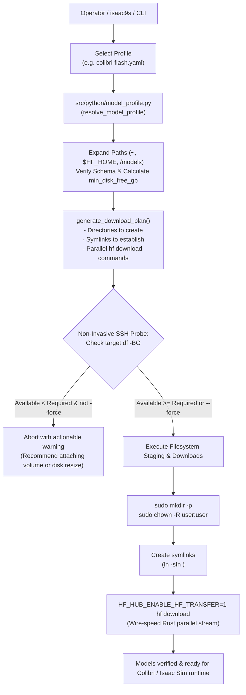

# Declarative Model Profiles & High-Speed Provisioning Plan

**Status:** Implementation In Progress (Phases 1–3 Complete; Phases 4–5 Planned)  
**Target Subsystems:** Model Configuration Layer (`configs/models/`), Model Profile Parser (`src/python/model_profile.py`), Standalone Downloader (`download-models`), and isaac9s Cockpit (`src/tui/screens/models.py`)  
**Target Environments:** Bare-Metal Robotics Workstations, Cloud Workstations (GCP, AWS, Azure), High-Speed NVMe Storage Arrays

---

## 1. Executive Summary & Architectural Motivation

Isaac Automator provisions remote GPU workstations for Isaac Sim, Isaac Lab, and Physical AI. Prior to this implementation, the repository decoupled:
1. **Cloud Infrastructure & Networking** in [`configs/profiles/`](file:///workspaces/IsaacAutomator/configs/profiles/) (VPC, GCP/AWS machine shape, GPU type, firewall, security tier).
2. **Software Stack & Desktop OS** in [`configs/workstations/`](file:///workspaces/IsaacAutomator/configs/workstations/) (Isaac Sim 6.0.1, Isaac Lab v3, KasmVNC, devtools).

### The Missing Layer: Model Weights & Checkpoints
Physical AI and robotics foundation models (e.g. **Colibrì GLM-5.3 MoE**, **NVIDIA Isaac-GR00T**, **LeRobot**, **Cosmos**) range from 10 GB to 400+ GB. 

Coupling model weights directly to either infrastructure or software profiles caused critical problems:
- **Lifecycle Mismatch:** Workstation OS and simulator binaries are provisioned once and change infrequently. Model checkpoints change frequently across experiments and benchmarks.
- **Extreme Disk & I/O Requirements:** MoE models (such as Colibrì's 744B flagship with 141 shards or 321B flash with 62 shards) require gigabytes-per-second sequential read speeds directly into GPU VRAM. They often live on dedicated high-speed NVMe drives (e.g. `/mnt/models_fast/` on `/dev/nvme1n1p1`).
- **Legacy Limitations:** The legacy Ansible `huggingface-artifacts` role was rigid: it enforced 40-character commit hashes, used a slow Python loop, and hardcoded staging to a hidden cache without configurable application paths or symlinks.

**The Solution:** Establish the **Triad of Separation of Concerns**:
```
configs/
├── profiles/      # Layer 1: Infrastructure & Cloud (where it runs)
├── workstations/  # Layer 2: Simulators, OS, & Devtools (what tools run)
└── models/        # Layer 3: Model Weights & Checkpoints (what weights it loads)
```

---

## 2. Storage Topology: Bare-Metal Host vs. Cloud Workstation

### 2.1 Host Bare-Metal Architecture
The bare-metal host uses hardware-accelerated dual NVMe storage to achieve the read throughput needed for dynamic MoE expert streaming:
- **Primary OS Disk (`/dev/nvme0n1`):** System, workspace, and tooling.
- **Secondary Fast NVMe (`/dev/nvme1n1p1`):** Mounted at `/mnt/models_fast/` (symlinked as `/mnt/nvme1`).
  - Model weights directory: `/mnt/models_fast/models/`
  - GLM-5.3 (744B Flagship, ~419 GB, 141 shards): `/mnt/models_fast/models/glm-5.3/`
  - GLM-5.3-Flash (321B Multimodal, ~182 GB, 62 shards): `/mnt/models_fast/models/glm-5.3-flash/`
  - Local cache & archive: `/mnt/models_fast/hf_cache/`, `/mnt/models_fast/archive/models/`
- **Application Mounts & Symlinks:**
  - Container mount: `/home/tarfy/models` mounted to `/models` inside containers.
  - Dual-NVMe streaming mirror: `/home/tarfy/models_mirror`.

### 2.2 Cloud Workstation Reality (`studio-workstation` on GCP)
- Currently provisioned with a single 255 GB boot disk (`/dev/nvme0n1p1`), with **129 GB free**.
- Downloading 182 GB (`GLM-5.3-Flash`) or 419 GB (`GLM-5.3`) directly onto root will exhaust disk space.
- Cloud solution:
  - **Option A (Attached High-Speed Volume):** Create and attach a 500 GB – 1 TB GCP `pd-ssd` or `Hyperdisk` formatted and mounted at `/mnt/models_fast`, with symlink `/models -> /mnt/models_fast/models`.
  - **Option B (Boot Disk Expansion):** Online resize of the GCP boot disk to 500 GB+ and creating `/mnt/models_fast/models` on root.
  - **Option C (Pruned / Quantized Variants):** Deploying sub-100 GB quantized weights directly into the existing 129 GB free space.

### 2.3 The Unified Logical Presentation Contract
Regardless of physical hardware (multi-NVMe bare-metal vs attached cloud PD), applications and containers always access models via the **logical contract**:
- Primary: `/models/glm-5.3` and `/models/glm-5.3-flash`
- Compatibility symlinks: `/mnt/models_fast/models/` and `~/models/`

---

## 3. Cloud Storage Performance, IOPS, & MoE Streaming Bottlenecks

A common pitfall in AI cloud deployments is treating cloud virtual disks like physical bare-metal NVMe drives. For conventional workloads or small models that fit entirely into GPU VRAM (e.g. Isaac-GR00T, LeRobot), disk speed only impacts initial boot/cold-start load times. However, for **Colibrì Dynamic MoE Expert Streaming**, storage throughput is the **direct runtime bottleneck for token generation**.

### 3.1 The MoE Dynamic Paging Mechanism
During token generation, the MoE router dynamically selects top-k active experts per layer. If weights are not resident in VRAM, the engine must stream safetensors shards from storage into GPU memory in real-time. If the storage subsystem cannot deliver gigabytes-per-second sequential throughput and low-latency random IOPS, the GPU compute engines starve, causing continuous disk-bound page faults.

### 3.2 Throughput, IOPS, & Token Latency Comparison

| Storage Tier / Environment | Sequential Read Throughput | Random Read IOPS | Colibrì MoE Generation Latency | Real-World Viability |
| :--- | :--- | :--- | :--- | :--- |
| **Bare-Metal Host**<br>(Dedicated PCIe 4.0/5.0 NVMe `/dev/nvme1n1`) | **7,000 – 14,000 MB/s**<br>(7 – 14 GB/s) | **800,000 – 1,500,000** | **10 – 25+ tok/s**<br>(Smooth interactive chat) | **Optimal**<br>(Production reference) |
| **Cloud Standard Disk**<br>(GCP `pd-balanced` / AWS `gp3` baseline) | **150 – 250 MB/s** | **3,000 – 6,000** | **0.1 – 0.5 tok/s**<br>(Severe stall; seconds per token) | **Unusable**<br>(Do not run MoE streaming) |
| **GCP Hyperdisk Throughput**<br>(Provisioned to `g4-standard-48` ceiling) | **1,600 MB/s**<br>(1.6 GB/s) | **75,000** | **2 – 5 tok/s**<br>(Tolerable, but sluggish) | **Marginal**<br>(Requires max provisioned PD) |
| **Cloud Local NVMe SSD**<br>(GCP Local SSD / AWS Instance Store) | **4,000 – 9,600 MB/s**<br>(4 – 9.6 GB/s) | **660,000 – 2,400,000** | **10 – 25 tok/s**<br>(Matches bare-metal NVMe) | **Optimal for Cloud**<br>(Requires local NVMe attachment) |
| **Host System RAM Offload**<br>(`/dev/shm` / tmpfs over PCIe 5.0) | **28,500 – 60,000 MB/s**<br>(Verified 28.5 GB/s on VM) | **Millions** | **30 – 60+ tok/s**<br>(Blazing fast throughput) | **Best for Models ≤ Host RAM**<br>(Ideal for GLM-5.3-Flash) |

### 3.3 Cloud Hypervisor Limits (`g4-standard-48` and AWS `g5`)

1. **Google Cloud `g4-standard-48` Limits:**
   - **Machine Profile:** 48 vCPUs, 192 GB DDR5 RAM, 1x NVIDIA RTX PRO 6000 Blackwell (96 GB VRAM, `sm_120`).
   - **Hypervisor Block Storage Cap:** The VM enforces an aggregate limit of **1,600 MiB/s (1.6 GB/s) and 75,000 IOPS** across all network persistent disks (including Hyperdisk). Any provisioned performance above this ceiling is throttled by the hypervisor.
   - **Default Boot Disk Reality:** The provisioned 255 GB `pd-balanced` boot disk has an effective throughput of ~200 MB/s, which will choke MoE streaming.
2. **AWS EC2 Limits (`g5.12xlarge` / `g4dn`):**
   - Standard EBS `gp3` volumes default to 125 MB/s and 3,000 IOPS.
   - Network EBS latency (1–2 ms queue delay per request) induces high tail latency on fine-grained shard reads, even when provisioned with higher burst bandwidth.

### 3.4 Production Patterns Used by AI Infrastructure Teams

Based on industry engineering practices (vLLM, DeepSpeed-MoE, Apple LLM in a Flash research):

- **Pattern 1: Ephemeral Local NVMe SSDs (Instance Store):**
  - Teams bypass network block storage entirely by attaching GCP Local SSDs (375 GB NVMe blocks physically co-located in the hypervisor chassis) or AWS Instance Stores.
  - A 2-disk RAID 0 stripe across 2x 375 GB Local SSDs yields 750 GB of storage with **6+ GB/s sequential reads and 1,000,000+ IOPS**, matching physical workstation performance.
  - *Lifecycle handling:* Local SSDs are ephemeral. Checkpoints are archived in GCS/S3 and re-synced to `/mnt/models_fast` upon VM start via background systemd tasks or Automator data transfer.
- **Pattern 2: Host Memory Offloading (`/dev/shm` / RAM Disk):**
  - Because `g4-standard-48` has **192 GB of high-speed host RAM**, models like GLM-5.3-Flash (182 GB) can be mapped into host memory.
  - Live empirical testing on `studio-workstation` verified **28.5 GB/s memory-read bandwidth**. Streaming active weights from host RAM to GPU VRAM over the PCIe 5.0 bus is **2x–4x faster than even physical NVMe**.
- **Pattern 3: Kernel Asynchronous I/O (`io_uring` + `O_DIRECT`):**
  - Advanced inference engines bypass synchronous `read()` calls using Linux `io_uring` with kernel polling.
  - Speculative prefetching predicts the top candidate experts for the next token layer and pages them asynchronously while the current token's attention heads compute on the GPU.

---

## 4. Declarative Schema Specification (`configs/models/*.yaml`)

Each model profile is a declarative YAML document adhering to `schema_version: v1`:

```yaml
schema_version: v1
model_profile_name: colibri-streaming
description: "Colibri Streaming MoE layout for dual-drive NVMe host or high-throughput cloud storage"

# Global defaults
defaults:
  provider: huggingface           # huggingface, modelscope, url, s3
  download_engine: hf_transfer    # hf_transfer (Rust fast transfer) or hf_cli
  auth_env: HF_TOKEN             # Target/host environment variable for authentication

# Storage topology configuration
storage:
  physical_dir: /mnt/models_fast/models
  logical_mounts:
    - target: /models
      link_to: /mnt/models_fast/models
    - target: ~/models
      link_to: /mnt/models_fast/models
    - target: /mnt/nvme1
      link_to: /mnt/models_fast

# Declared models and checkpoint shards
models:
  - name: glm-5.3-flash
    description: "321B MoE Multimodal (62 shards, ~182 GB)"
    repo_id: zai-org/GLM-5.3-Flash
    repo_type: model             # model or dataset
    revision: main               # branch, tag, or commit hash
    destination: /mnt/models_fast/models/glm-5.3-flash
    symlinks:
      - /models/glm-5.3-flash
      - /models/glm-5.3
    allow_patterns:
      - "*.safetensors"
      - "*.json"
      - "*.txt"
      - "tokenizer*"
    ignore_patterns:
      - "*.bin"
    min_disk_free_gb: 190
```

---

## 5. Architecture & Lifecycle Flow



---

## 6. Implementation Roadmap & Status

### Phase 1: Core Engine & Presets (DONE)
- [x] Create [`configs/models/`](file:///workspaces/IsaacAutomator/configs/models/) directory.
- [x] Create reference profile [`configs/models/example-model.yaml`](file:///workspaces/IsaacAutomator/configs/models/example-model.yaml).
- [x] Create Colibrì Flash profile [`configs/models/colibri-flash.yaml`](file:///workspaces/IsaacAutomator/configs/models/colibri-flash.yaml).
- [x] Create Colibrì Streaming MoE profile [`configs/models/colibri-streaming.yaml`](file:///workspaces/IsaacAutomator/configs/models/colibri-streaming.yaml).
- [x] Create Isaac-GR00T foundation profile [`configs/models/gr00t-foundation.yaml`](file:///workspaces/IsaacAutomator/configs/models/gr00t-foundation.yaml).
- [x] Implement [`src/python/model_profile.py`](file:///workspaces/IsaacAutomator/src/python/model_profile.py) parser, resolver, and plan generator.
- [x] Implement unit tests in [`src/tests/model_profile.test.py`](file:///workspaces/IsaacAutomator/src/tests/model_profile.test.py) (6/6 passing).

### Phase 2: Standalone CLI Downloader (DONE)
- [x] Implement [`./download-models`](file:///workspaces/IsaacAutomator/download-models) wrapper.
- [x] Add non-invasive pre-flight storage check via SSH (`df -BG`).
- [x] Support `--dry-run`, `--force`, and `--debug` flags.
- [x] Verified live dry-run against `studio-workstation` (detected 129 GB free root disk vs. 190 GB required).

### Phase 3: isaac9s Cockpit Integration (DONE)
- [x] Create `ModelsPane` in [`src/tui/screens/models.py`](file:///workspaces/IsaacAutomator/src/tui/screens/models.py).
- [x] Add **Models & Weights [7]** tab to [`src/tui/app.py`](file:///workspaces/IsaacAutomator/src/tui/app.py).
- [x] Provide split-view: profile summary table on left, rich YAML breakdown and command preview on right.
- [x] Wire `[d] Download` and `[v] Dry-Run Plan` buttons directly into background execution and the live logs pane.
- [x] Add command palette support (`:models`, `:model`, `7`).

### Phase 4: High-Performance Cloud Storage Provisioning (PLANNED)
- [ ] Implement cloud storage provisioning choices in Automator:
  - **Strategy A (Local SSD Array):** Attach 2x 375 GB GCP Local NVMe SSDs in RAID 0 at `/mnt/models_fast` for bare-metal parity (6+ GB/s reads, 1M+ IOPS).
  - **Strategy B (Host RAM tmpfs):** Mount `/models` on `/dev/shm` (or 180 GB tmpfs) for GLM-5.3-Flash, delivering 28.5 GB/s memory-speed streaming.
  - **Strategy C (Hyperdisk Throughput):** Attach a dedicated Hyperdisk volume provisioned up to the VM's 1,600 MB/s hypervisor limit.
- [ ] Test live streaming inference with Colibrì and benchmark token decode latency.

### Phase 5: Local Cache Direct Sync (PLANNED)
- [ ] If weights already exist on host (`/home/tarfy/.cache/huggingface/hub/` or `/mnt/models_fast/`):
  - Support `./transfer-data` / `rsync` direct pipeline to stream pre-downloaded shards directly from the bare-metal host to the cloud VM over SSH.
  - Skip re-downloading 180+ GB over public Hugging Face mirrors when local cached blobs are available.

---

## 7. Verification & Quality Gates

| Test Suite | Command | Scope |
| :--- | :--- | :--- |
| **Model Profile Unit Tests** | `python3 src/tests/model_profile.test.py` | Schema parsing, path expansions, plan generation, and error handling. |
| **CLI Dry-Run Verification** | `./download-models studio-workstation --profile colibri-flash --dry-run` | Live SSH connection, remote `df` disk query, command generation. |
| **TUI Cockpit Integration** | `.venv-isaac9s/bin/python -c "from src.tui.app import Isaac9sApp; Isaac9sApp()"` | Textual UI mount, tab switching, and button dispatch verification. |
