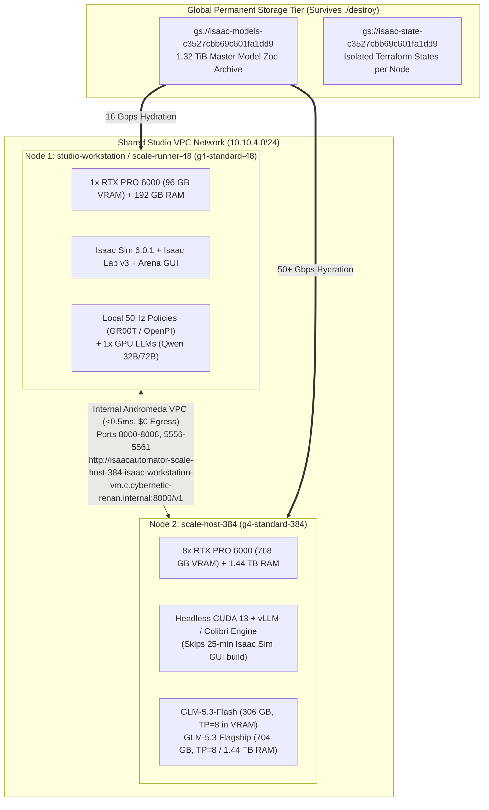

# Dual-Instance Heterogeneous Cluster & Shared VPC Fabric Plan

**Status:** Planned (Future Performance & Scale Architecture)  
**Target Subsystems:** Terraform Networking (`src/terraform/gcp/ovkit/security.tf`, `variables.tf`), Cluster Orchestrator (`./deploy-cluster`), Software Profiles (`configs/workstations/model-host-headless.yaml`), Infrastructure Profiles (`configs/profiles/large-scale-studio-enterprise.yaml`), and Model Hydration (`./download-models`)  
**Related References:** [`../notes/architectural_limitations.md`](../notes/architectural_limitations.md), [`./declarative-model-profiles-plan.md`](./declarative-model-profiles-plan.md), [`./network-plans.md`](./network-plans.md)

---

## 1. Executive Summary & Architectural Motivation

Physical AI and autonomous robotics evaluation workloads combine two fundamentally different compute paradigms:
1. **Closed-Loop Physics Simulation & Agile Policies (`1x RTX PRO 6000`, `g4-standard-48`):**
   - Runs **Isaac Sim 6.0.1**, **Isaac Lab v3**, **IsaacLab-Arena**, 50 Hz closed-loop robotics policies (`gr00t-n1.7-3b`, `openpi-pi05-droid-jointpos`, `gr00t-n1.6-droid`), 3D geometric/visual critics (`da3metric-large`, `moge-2-vitl`, `qwen2.5-vl-7b-instruct`), and 32B–72B quantized specification LLMs (`qwen2.5-72b-instruct-awq`, `qwen3-32b-fp8`, `deepseek-r1-distill-qwen-32b`).
   - All of these fit inside a single **96 GB GDDR7 GPU** + **192 GB DDR5 Host RAM** page cache (`~$2.25/hr`).
2. **Frontier MoE Foundation Model Serving (`8x RTX PRO 6000`, `g4-standard-384`):**
   - Runs massive unquantized / FP8 Mixture-of-Experts foundation models—specifically **`glm-5.3-flash`** (`306 GB` `.safetensors`, 62 shards) and **`glm-5.3`** (`704 GB` `.safetensors`, 141 shards)—requiring **768 GB aggregate GDDR7 VRAM** (`TP=8`) and **1,440 GB (1.44 TB) DDR5 Host RAM** (`~$18.00/hr`).

### Why Loosely-Coupled Dual Instances Beat a Monolithic Cluster
As documented in [`../notes/architectural_limitations.md`](../notes/architectural_limitations.md), Isaac Automator's `1 Deployment Name = 1 Cloud VM` boundary is a **critical operational advantage** for cost and scheduling resilience:
- **Independent Lifecycle & Cost Control (`./stop scale-host-384`):** Engineers spend ~80% of time developing in Isaac Sim/Arena on the `1x GPU` workstation (`$2.25/hr`) and only boot the `8x GPU` host (`$18.00/hr`) during frontier MoE specification synthesis or batch benchmark sweeps—saving **~$15.75/hr** whenever `GLM-5.3` inference is idle.
- **Decoupled DWS Flex-Start Provisioning:** On GCP, requesting `1x GPU` (`g4-standard-48`) via Dynamic Workload Scheduler (Flex-start) succeeds in 1–2 minutes, whereas `8x GPU` (`g4-standard-384`) may queue longer for contiguous multi-GPU chassis allocation. Keeping them in separate Terraform states ensures an 8-GPU stockout never blocks single-GPU simulation work.
- **Zero Duplicate Internet Downloads via Global GCS Archive:** Because all **1.32 TiB (`1,451,577,564,137` bytes)** of model weights live permanently in **`gs://isaac-models-c3527cbb69c601fa1dd9/models/`**, both the `1x GPU` runner and the `8x GPU` host hydrate their respective model subsets directly over Google's internal Andromeda network (`16–50+ Gbps`) with zero Hugging Face Hub bottleneck.

---

## 2. Empirical Model Partitioning: `1x RTX PRO 6000` vs. `8x RTX PRO 6000`

Based on the live provisioning and GCS archiving of [`configs/models/complete-model-zoo.yaml`](../../../configs/models/complete-model-zoo.yaml) onto `studio-workstation` and `gs://isaac-models-c3527cbb69c601fa1dd9`, the 17-model catalog partitions across the two instances as follows:

| Target Node | Machine Shape & Specs | Assigned Models from `complete-model-zoo.yaml` | Empirical On-Disk Size | Execution & Memory Strategy |
| :--- | :--- | :--- | :--- | :--- |
| **Node 1: Simulation & Agile Workstation**<br>(`studio-workstation` / `scale-runner-48`) | **`g4-standard-48`**<br>• 1x RTX PRO 6000 (`96 GB VRAM`)<br>• 48 vCPUs<br>• `192 GB` DDR5 RAM | **50 Hz Closed-Loop Policies (Port 5556 / 8008):**<br>• `gr00t-n1.7-3b`, `gr00t-n1.6-droid`<br>• `openpi-pi05-droid-jointpos`<br>**Visual & 3D Critics (Port 8001 / 8002):**<br>• `da3metric-large`, `moge-2-vitl`<br>• `qwen2.5-vl-7b-instruct`, `cosmos-reason2-2b`<br>• `qwen3-vl-32b-thinking` (`61 GB`)<br>**1-GPU Spec LLMs (Port 8000):**<br>• `qwen2.5-72b-instruct-awq` (`41 GB`)<br>• `qwen2.5-VL-72B-Instruct-AWQ` (`42 GB`)<br>• `qwen2.5-coder-32b-instruct-awq` (`19 GB`)<br>• `qwq-32b-awq` (`19 GB`)<br>• `qwen3-32b-fp8` (`34 GB`), `qwen3-30b-a3b-fp8` (`31 GB`)<br>• `deepseek-r1-distill-qwen-32b` (`62 GB`) | **`~340 GB` total**<br>(Fits on a `500 GB` zonal disk or the existing `1,800 GB` full-zoo disk) | • Sim + 50 Hz policies + 3D critics + any 32B–72B AWQ/FP8 model run **100% locally in 96 GB VRAM**.<br>• `113 GB` of active policy/critic weights are locked in the `192 GB` Host RAM page cache via `vmtouch` (`28.5 GB/s`). |
| **Node 2: Frontier MoE Model Host**<br>(`scale-host-384`) | **`g4-standard-384`**<br>• 8x RTX PRO 6000 (`768 GB VRAM`)<br>• 384 vCPUs<br>• `1,440 GB` (`1.44 TB`) DDR5 RAM | **Frontier MoE Synthesizers (Port 8000 / 8001):**<br>• `glm-5.3-flash` (321B MoE, 62 shards)<br>• `glm-5.3` (744B Flagship MoE, 141 shards)<br>• Optional co-hosted `qwen2.5-vl-72b-instruct-awq` or `qwen3-vl-32b-thinking` on dedicated GPUs | **`306 GB`** (`glm-5.3-flash`)<br>**`704 GB`** (`glm-5.3`)<br>**`1,010 GB` combined** | • **`glm-5.3-flash` (`306 GB`)** loads **100% into 768 GB VRAM** across 8 GPUs (`TP=8`), leaving **~460 GB VRAM** for massive context KV caches.<br>• **`glm-5.3` (`704 GB`)** loads into `768 GB VRAM` (`TP=8`) or streams zero-latency from the **`1.44 TB` Host RAM** page cache (`vmtouch`). |

---

## 3. Identified Networking Gap in Current Single-Node Terraform

While [`configs/profiles/large-scale-studio-enterprise.yaml`](../../../configs/profiles/large-scale-studio-enterprise.yaml) declares `subnet_cidr: "10.10.4.0/24"` and a `cluster_topology` block, an audit of [`src/terraform/gcp/ovkit/security.tf`](../../../src/terraform/gcp/ovkit/security.tf) revealed three networking blockers that must be resolved when implementing this plan:

1. **Per-Deployment Isolated VPCs (`security.tf:1-4`):**
   - Currently, every `./deploy-gcp --deployment-name <name>` creates a brand-new, isolated VPC network named `${var.prefix}-network` (`isaacautomator-<name>-isaac-workstation-network`).
   - Consequently, `studio-workstation` (or `scale-runner-48`) and `scale-host-384` land in **two disconnected VPC networks** that cannot route internal traffic to each other.
2. **Hardcoded Overlapping Subnet CIDR (`security.tf:6-13`):**
   - `google_compute_subnetwork.default` hardcodes `ip_cidr_range = "10.10.0.0/24"` instead of reading `var.subnet_cidr`.
   - Both VMs are assigned the exact same private IP (`10.10.0.2`) in separate VPCs, which prevents even VPC Peering from working due to CIDR overlap.
3. **Missing Internal Inference Firewall Rules (`security.tf:74-200`):**
   - Existing firewall rules only open external ingress (`var.ingress_cidrs`) for desktop/SSH ports (`22, 4000, 5900, 6080, 8211, 8443, 8444`).
   - There is no internal VPC firewall rule allowing the simulation runner (`scale-runner-48`) to reach the model host (`scale-host-384`) on inference ports (`8000` Spec LLM, `8001` Visual Critic, `8002` Depth/Normal Oracle, `5556/5561` GR00T ZMQ, `8008` OpenPI).

---

## 4. Target Architecture: Shared VPC Fabric & Headless Model Host



---

## 5. Step-by-Step Implementation Plan (When Ready to Execute)

### Phase 1: Shared VPC Subnet & Internal Inference Firewall in Terraform
**Files to Modify:**
- [`src/terraform/gcp/variables.tf`](../../../src/terraform/gcp/variables.tf), [`src/terraform/gcp/main.tf`](../../../src/terraform/gcp/main.tf)
- [`src/terraform/gcp/ovkit/variables.tf`](../../../src/terraform/gcp/ovkit/variables.tf), [`src/terraform/gcp/ovkit/security.tf`](../../../src/terraform/gcp/ovkit/security.tf), [`src/terraform/gcp/ovkit/main.tf`](../../../src/terraform/gcp/ovkit/main.tf)
- [`src/python/deploy_command.py`](../../../src/python/deploy_command.py), [`src/python/deployer.py`](../../../src/python/deployer.py)

**Changes:**
1. **Parameterize `subnet_cidr` (`default = "10.10.0.0/24"`):**
   - Pass `security.network.subnet_cidr` from the YAML profile into `ovkit/security.tf` so `10.10.4.0/24` is applied.
2. **Add `shared_network_deployment` (Join Existing Workstation VPC):**
   - Add an optional Terraform variable `shared_network_name` / `shared_subnetwork_name` (or CLI flag `--join-network <deployment_name>`).
   - When `shared_network_name == ""` (default): creates `google_compute_network.default` and `google_compute_subnetwork.default` as today.
   - When `shared_network_name != ""` (e.g., `scale-host-384` joining `studio-workstation`'s VPC): looks up the existing `data "google_compute_network"` and `data "google_compute_subnetwork"` and attaches the second VM's NIC directly to the primary workstation's subnet!
   - **Benefit:** Both VMs receive internal IPs on the same subnet (`10.10.4.2` and `10.10.4.3`) and automatically resolve each other via GCP internal DNS (`<vm-name>.c.<project>.internal`) with zero NAT or VPC Peering overhead.
3. **Add Internal East-West Inference Firewall Rule (`google_compute_firewall.internal_inference`):**
   - Allow internal subnet traffic (`source_ranges = [var.subnet_cidr]`) across TCP/UDP ports:
     - `8000` (Spec LLM: vLLM / Colibrì `GLM-5.3-Flash`, `GLM-5.3`, `Qwen2.5-72B`)
     - `8001` (Visual Critic: `Qwen2.5-VL`, `Qwen3-VL-32B-Thinking`, `Cosmos-Reason2-2B`)
     - `8002` (3D Geometry Oracle: `DA3METRIC-LARGE`, `MoGe-2`)
     - `5556-5561` (Closed-Loop `gr00t-server` ZeroMQ)
     - `8008` (Closed-Loop `openpi-server` WebSocket/HTTP)
     - `3009-3180` (Omniverse Nucleus internal collaboration ports)

---

### Phase 2: Fast Headless Software Profile for the 8x GPU Model Host
**Files to Create/Modify:**
- `configs/workstations/model-host-headless.yaml` (New lightweight software profile)

**Motivation:**
- Installing the full GUI desktop (NoMachine, KasmVNC, Isaac Sim 6.0.1 Standalone, Isaac Lab v3) takes ~20–25 minutes. On a `$18.00/hr` `g4-standard-384` (8x GPU) instance, spending 25 minutes compiling GUI/simulation extensions wastes ~$7.50 on software the model host never uses.
- Creating `configs/workstations/model-host-headless.yaml` provisions **only**:
  - NVIDIA Driver + CUDA 13.x (`sm_120` Blackwell support)
  - Docker + NVIDIA Container Toolkit
  - Dedicated `model-storage` role (`/mnt/models_fast`, `vmtouch`, `vm.swappiness=1`, `/etc/isaac-models.env`)
  - Python `uv` / Conda environment with `vllm`, `huggingface_hub[hf_transfer]`, and Colibrì/ZMQ serving daemons.
- **Result:** Provisioning time for `scale-host-384` drops from ~25 minutes to **~3–4 minutes**.

---

### Phase 3: Selective GCS Hydration & Endpoint Wiring (`./deploy-cluster`)
**Files to Create/Modify:**
- [`configs/profiles/large-scale-studio-enterprise.yaml`](../../../configs/profiles/large-scale-studio-enterprise.yaml)
- `./deploy-cluster` (Optional Phase 1 composite CLI wrapper)

**Workflow when launching the 2-instance experiment:**
1. **Instance 1 (`studio-workstation` — `g4-standard-48`, `1x RTX PRO 6000`):**
   - Already deployed and hydrated with the 16-model zoo on `/mnt/models_fast` (`1,800 GB` Hyperdisk).
   - Runs Isaac Sim 6.0.1, IsaacLab-Arena, 50 Hz policies (`GR00T-N1.7-3B`, `OpenPI`), and single-GPU LLMs (`Qwen2.5-72B-Instruct-AWQ`, `Qwen3-32B-FP8`, `DeepSeek-R1-Distill-Qwen-32B`).
2. **Instance 2 (`scale-host-384` — `g4-standard-384`, `8x RTX PRO 6000`):**
   - Deployed into the same VPC network:
     ```bash
     ./deploy-gcp --deployment-name scale-host-384 \
       --profile large-scale-studio-enterprise \
       --join-network studio-workstation \
       --existing replace
     ```
   - Hydrates **only** the massive MoE models directly from your permanent GCS archive (`gs://isaac-models-c3527cbb69c601fa1dd9/models/`) at 50+ Gbps:
     ```bash
     ./download-models scale-host-384 \
       --profile complete-model-zoo \
       --models glm-5.3-flash,glm-5.3 \
       --warmup-ram
     ```
   - Automatically exports `ISAAC_REMOTE_SPEC_LLM_URL="http://<scale-host-384-internal-ip>:8000/v1"` into `/etc/isaac-models.env` on `studio-workstation`.
3. **Independent Cost Control:**
   - When finished with `8x GPU` `GLM-5.3` runs, stop or destroy **only** `scale-host-384`:
     ```bash
     ./stop scale-host-384
     # or
     ./destroy scale-host-384 --yes
     ```
   - `studio-workstation` (`1x GPU`) and `gs://isaac-models-c3527cbb69c601fa1dd9` remain 100% untouched.

---

## 6. Verification Checklist (For Future Implementation)
- [ ] `terraform validate` passes on `src/terraform/gcp` with `shared_network_name` both empty (standalone VPC) and populated (shared VPC).
- [ ] `studio-workstation` (`10.10.4.2`) and `scale-host-384` (`10.10.4.3`) can `ping` and `curl http://10.10.4.3:8000/v1/models` with `< 0.5 ms` RTT over internal VPC.
- [ ] `./download-models scale-host-384 --profile complete-model-zoo --models glm-5.3-flash` pulls all 62 shards (`306 GB`) via **Tier-2 GCS Hydration** from `gs://isaac-models-c3527cbb69c601fa1dd9/models/glm-5.3-flash/` without hitting Hugging Face Hub.
- [ ] `./stop scale-host-384` and `./destroy scale-host-384 --yes` cleanly tear down the 8x GPU instance without disrupting `studio-workstation` or `gs://isaac-models-c3527cbb69c601fa1dd9`.
