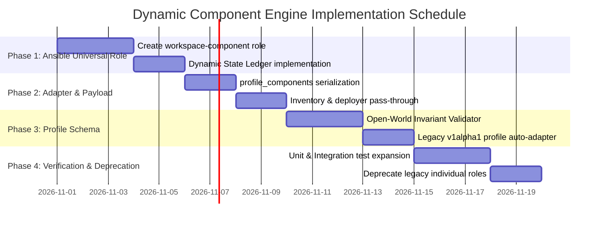

# Dynamic Component Manifest Engine: Open-World Physical AI Stack Architecture

**Status:** Proposed Architecture & Implementation Plan  
**Target Subsystems:**
- Profile Schema & Validation ([`src/python/workstation_profile.py`](file:///workspaces/IsaacAutomator/src/python/workstation_profile.py))
- Profile Adapters & Translation ([`src/python/profile_adapters.py`](file:///workspaces/IsaacAutomator/src/python/profile_adapters.py))
- Deployer & Inventory Serialization ([`src/python/deployer.py`](file:///workspaces/IsaacAutomator/src/python/deployer.py), [`src/ansible/inventory.template`](file:///workspaces/IsaacAutomator/src/ansible/inventory.template))
- Ansible Orchestration Engine ([`src/ansible/roles/workspace-component/`](file:///workspaces/IsaacAutomator/src/ansible/roles/workspace-component/), [`src/ansible/roles/isaac-workstation/meta/main.yml`](file:///workspaces/IsaacAutomator/src/ansible/roles/isaac-workstation/meta/main.yml))
- Verification & State Ledger ([`src/ansible/roles/state-ledger/tasks/main.yml`](file:///workspaces/IsaacAutomator/src/ansible/roles/state-ledger/tasks/main.yml))

---

## 1. Executive Summary & Problem Statement

Isaac Automator deploys physical AI workstations capable of running Isaac Sim 6.0.1, Isaac Lab v3, IsaacLab-Arena, Isaac-GR00T, LeRobot, and custom robotics software. However, the system currently suffers from an architectural anti-pattern: **the profile specification and provisioning engine treat components as closed-world static enums rather than an open-world declarative manifest**.

### Current Limitations
1. **Multi-Layer Hardcoding**: Adding or modifying any repository, benchmark, or model (e.g. `robolab`, custom ROS2 nodes, external VLAs, or laboratory forks) requires invasive code changes across at least **7 files**:
   - Closed tuples in [`src/python/workstation_profile.py`](file:///workspaces/IsaacAutomator/src/python/workstation_profile.py) (`COMPONENTS`, `RUNTIMES`, `COMPONENT_RUNTIME`, `DEPENDENCIES`).
   - Constant dictionaries, loop tuples, and hardcoded flag blocks in [`src/python/profile_adapters.py`](file:///workspaces/IsaacAutomator/src/python/profile_adapters.py) (`REPO_DIRS`, `LEGACY_NAMES`, `install_gr00t`, `install_robolab`).
   - Boilerplate Ansible roles created for each single repository (`roles/robolab`, `roles/lerobot`, `roles/gr00t`, etc.).
   - Static dependency list in [`src/ansible/roles/isaac-workstation/meta/main.yml`](file:///workspaces/IsaacAutomator/src/ansible/roles/isaac-workstation/meta/main.yml).
   - Hardcoded discrete probe tasks and rigid JSON templating in [`src/ansible/roles/state-ledger/tasks/main.yml`](file:///workspaces/IsaacAutomator/src/ansible/roles/state-ledger/tasks/main.yml).
2. **Developer & Operator Friction**: Operators cannot test alternative forks, custom robotics repositories, or new foundation models simply by declaring them in their YAML profile. The profile validator rejects unexpected component keys before provisioning even starts.
3. **Ansible Role Proliferation & Playbook Overhead**: Every new tool duplicates 80% of git clone/remote configuration and pip installation tasks, inflating maintenance overhead and slowing playbook execution.

### The Objective
Migrate Isaac Automator to an **Open-World, Manifest-Driven Component Engine**. Operators must be empowered to declare arbitrary repositories, git references, dual-remote tracking (fork + upstream), environment bindings (pip, conda, uv, script), and desktop launchers **entirely within their YAML profile (`configs/workstations/*.yaml`) without writing or modifying a single line of Python or Ansible code**.

---

## 2. Core Architectural Invariants

| Principle | Old Closed-World Architecture | Target Open-World Architecture |
| :--- | :--- | :--- |
| **Component Extensibility** | Hardcoded tuple `('sim', 'lab', 'arena', 'gr00t', 'lerobot', 'robolab')` | Manifest-driven: arbitrary component IDs declared in YAML list. |
| **Schema Validation** | Strict key-identity matching. Any unknown key raises `ProfileError`. | Invariant-based validation: validates HTTPS URLs, valid git refs, directory paths, and runtime target existence. |
| **Ansible Orchestration** | Monolithic sequence of discrete per-tool roles (`roles/robolab`, `roles/lerobot`, etc.). | Universal parameterized role (`roles/workspace-component/`) dynamically iterating over `profile_components`. |
| **Runtime Placement** | Hardcoded 1-to-1 mapping (`gr00t -> uv`, `lab -> conda`). | Configurable runtime targets: each component declares which runtime environment executes its build/install. |
| **Audit Ledger** | Hardcoded discrete git probe shell tasks and rigid JSON template in `state-ledger`. | Dynamic ledger engine looping over resolved components and generating immutable audit receipt. |
| **Backward Compatibility** | N/A (breaking change risk). | 100% backward compatible: legacy `v1alpha1` dictionary profiles are seamlessly converted into normalized component manifests. |

---

## 3. High-Level Architecture Flow

```mermaid
flowchart TD
    ProfileYAML["Workstation Profile YAML\n(configs/workstations/*.yaml)"] --> Parser["Profile Parser & Validator\n(src/python/workstation_profile.py)"]
    
    subgraph Python Validation & Translation
        Parser --> InvariantCheck{"Invariant Validator:\n- Valid HTTPS URLs\n- Safe path strings\n- Known runtime refs"}
        InvariantCheck -->|Pass| Adapter["Profile Adapter\n(src/python/profile_adapters.py)"]
        Adapter --> Normalize["Normalize into Open-World Manifest:\nprofile_components: [...]"]
        Normalize --> ExportJSON["Serialize into Ansible Extra Vars / Inventory"]
    end

    subgraph Ansible Provisioning Engine
        ExportJSON --> MainPlaybook["isaac-workstation Playbook"]
        MainPlaybook --> SetupRuntimes["Setup Declared Runtimes\n(conda: isaaclab, uv: gr00t, etc.)"]
        SetupRuntimes --> UniversalRole["Universal Component Role\n(roles/workspace-component)"]
        
        UniversalRole --> LoopComponents{"Loop over profile_components"}
        LoopComponents --> GitTask["1. Git Clone & Dual-Remote Setup\n(origin: user fork, upstream: official)"]
        GitTask --> InstallTask["2. Environment Binding & Installation\n(editable pip, uv, conda, or custom script)"]
        InstallTask --> DesktopTask["3. Desktop Shortcut Generation\n(optional .desktop launcher)"]
    end

    subgraph Dynamic Audit & State Ledger
        DesktopTask --> Ledger["Dynamic State Ledger\n(roles/state-ledger)"]
        Ledger --> ProbeLoop["Loop over profile_components:\nQuery HEAD commit SHA & working branch"]
        ProbeLoop --> OutputReceipt["Generate /etc/isaac_workstation/state_ledger.json"]
    end
```



---

## 4. Detailed Specification

### 4.1. Manifest Specification (`schema_version: v1alpha2`)

The new profile specification introduces a declarative `components` list and flexible `runtimes` definition:

```yaml
schema_version: v1alpha2
kind: workstation-profile
name: boredengineering-dev

workspace:
  root: ~/Documents/GitHub
  name: BoredEngineer

# Declared execution environments on the workstation
runtimes:
  kit:
    manager: bundled
    environment: kit
  lab:
    manager: conda
    environment: isaaclab
    python: "3.12"
    torch: "2.10.0+cu128"
  gr00t:
    manager: uv
    environment: gr00t
  lerobot:
    manager: conda
    environment: lerobot
    python: "3.10"

# Open-world components: arbitrary repositories and packages
components:
  - id: sim
    type: standalone
    runtime: kit
    url: https://downloads.isaacsim.nvidia.com/isaac-sim-standalone-6.0.1-linux-x86_64.zip
    sha256: 348013c4d3ac398d40162566d0edfe4f3837a0eb5efa358ec87065f81aa68dd7
    install_dir: ~/IsaacSim

  - id: lab
    type: git
    runtime: lab
    repository: https://github.com/boredengineering/IsaacLab.git
    ref: dev/arena_v0.3.0-compat
    upstream: https://github.com/isaac-sim/IsaacLab.git
    install:
      method: editable
    dependencies: [sim]

  - id: arena
    type: git
    runtime: lab
    repository: https://github.com/boredengineering/IsaacLab-Arena.git
    ref: dev/0.3.0-prerelease
    upstream: https://github.com/isaac-sim/IsaacLab-Arena.git
    install:
      method: editable
    dependencies: [lab]

  - id: robolab
    type: git
    runtime: lab
    repository: https://github.com/boredengineering/RoboLab.git
    ref: main
    upstream: https://github.com/NVlabs/RoboLab.git
    install:
      method: editable
    desktop_shortcut:
      name: RoboLab Dashboard
      exec: "/usr/local/bin/isaaclab-env python -m dashboard.cli"
      icon: "utilities-terminal"

  - id: custom_research_pkg
    type: git
    runtime: lab
    repository: https://github.com/user/custom-vla-teleop.git
    ref: feature/h1-control
    install:
      method: script
      command: "./setup.sh --cuda"
```

### 4.2. Invariant-Based Validation ([`src/python/workstation_profile.py`](file:///workspaces/IsaacAutomator/src/python/workstation_profile.py))

Instead of testing `component_name in COMPONENTS`, the new validator enforces security and structural invariants:

```python
class ComponentSpec:
    """Validates structural invariants of an open-world component."""
    
    @staticmethod
    def validate(comp: dict, valid_runtimes: set[str], seen_ids: set[str]):
        # 1. Identifier safety
        comp_id = comp.get("id")
        if not comp_id or not re.match(r"^[a-zA-Z0-9_\-]+$", comp_id):
            raise ProfileError(f"Component 'id' must be alphanumeric/dashes: {comp_id}")
        if comp_id in seen_ids:
            raise ProfileError(f"Duplicate component id '{comp_id}' in profile")
        
        # 2. Runtime linkage
        runtime = comp.get("runtime")
        if runtime and runtime not in valid_runtimes:
            raise ProfileError(f"Component '{comp_id}' specifies undeclared runtime '{runtime}'")
        
        # 3. Source repository validation
        if comp.get("type", "git") == "git":
            repo = comp.get("repository")
            if not repo or not (repo.startswith("https://") or repo.startswith("git@")):
                raise ProfileError(f"Component '{comp_id}': repository must be valid HTTPS or SSH URL")
            
            upstream = comp.get("upstream")
            if upstream and not (upstream.startswith("https://") or upstream.startswith("git@")):
                raise ProfileError(f"Component '{comp_id}': upstream must be valid HTTPS or SSH URL")
```

### 4.3. Profile Adapter Normalization ([`src/python/profile_adapters.py`](file:///workspaces/IsaacAutomator/src/python/profile_adapters.py))

The profile adapter translates the validated manifest into a structured JSON payload for Ansible:

```python
def render_profile(profile_path: str) -> dict[str, Any]:
    profile = load_profile(profile_path)
    # ...
    components_payload = []
    for comp in profile.components:
        comp_dict = {
            "id": comp.id,
            "type": comp.type,
            "runtime": comp.runtime,
            "dest": comp.resolve_dest_path(profile.workspace),
            "repository": comp.repository,
            "ref": comp.ref,
            "upstream": comp.upstream,
            "install_method": comp.install.get("method", "editable"),
            "install_command": comp.install.get("command"),
            "desktop_shortcut": comp.desktop_shortcut,
        }
        components_payload.append(comp_dict)
    
    artifact["profile_components"] = components_payload
    artifact["profile_components_json"] = json.dumps(components_payload)
    return artifact
```

### 4.4. Universal Ansible Role ([`src/ansible/roles/workspace-component/`](file:///workspaces/IsaacAutomator/src/ansible/roles/workspace-component/))

A single, idempotent role replaces the sprawling per-component roles:

1. **Git Checkout & Remote Tracking (`tasks/git.yml`)**:
   - Clones `component.repository` into `component.dest` at `component.ref`.
   - If `component.upstream` is defined, configures git remote `upstream` with fetch refspecs.
   - Sets safe directory configuration in git config.
2. **Environment Installation (`tasks/install.yml`)**:
   - Dispatches based on `component.install_method`:
     - `editable`: Runs `pip install -e .` inside the specified runtime (e.g. via `conda run -n <env>` or `uv run`).
     - `standard`: Runs `pip install .` in runtime.
     - `script`: Executes custom build script under workstation user context.
3. **Desktop Shortcut (`tasks/desktop.yml`)**:
   - If `component.desktop_shortcut` is present, renders a compliant XDG `.desktop` file into `/home/ubuntu/Desktop/` with executable permissions.

### 4.5. Dynamic State Ledger Engine ([`src/ansible/roles/state-ledger/`](file:///workspaces/IsaacAutomator/src/ansible/roles/state-ledger/))

The state ledger iterates over `profile_components` dynamically:

```yaml
- name: Query HEAD commit for git components
  ansible.builtin.command:
    cmd: "git rev-parse HEAD"
    chdir: "{{ item.dest }}"
  register: component_git_commit
  loop: "{{ profile_components }}"
  when: item.type == 'git'
  changed_when: false
  failed_when: false

- name: Assemble dynamic component ledger
  ansible.builtin.set_fact:
    component_ledger_entries: >-
      {{
        component_ledger_entries | default({}) | combine({
          item.item.id: {
            'dest': item.item.dest,
            'repository': item.item.repository,
            'ref': item.item.ref,
            'commit': item.stdout | default('N/A'),
            'upstream': item.item.upstream | default(none)
          }
        })
      }}
  loop: "{{ component_git_commit.results }}"
  when: item.skipped is not defined and item.rc == 0
```

---

## 5. Workstreams & Phased Implementation Plan



### Milestone 1: Universal Ansible Component Role & Dynamic State Ledger
- **Files**:
  - `src/ansible/roles/workspace-component/tasks/{main.yml,git.yml,install.yml,desktop.yml}`
  - `src/ansible/roles/workspace-component/defaults/main.yml`
  - `src/ansible/roles/workspace-component/meta/main.yml`
  - `src/ansible/roles/state-ledger/tasks/main.yml`
- **Deliverables**:
  - Implement parameterized role capable of cloning, remote setup, installing via `conda`/`uv`, and generating shortcuts.
  - Convert `state-ledger` into a dynamic loop that builds `state_ledger.json` from `profile_components`.

### Milestone 2: Dynamic Profile Adapter & Inventory Payload
- **Files**:
  - `src/python/profile_adapters.py`
  - `src/ansible/inventory.template`
  - `src/python/deployer.py`
- **Deliverables**:
  - Update `profile_adapters.py` to output `profile_components` list and `profile_components_json`.
  - Maintain backward-compatible boolean flags (`install_gr00t`, `install_robolab`, etc.) during transition.
  - Pass structured components through inventory extra vars.

### Milestone 3: Open-World Manifest Schema & Invariant Validator
- **Files**:
  - `src/python/workstation_profile.py`
  - `configs/workstations/boredengineering-dev.yaml`
  - `configs/workstations/studio-enterprise.yaml`
- **Deliverables**:
  - Replace closed-world tuples (`COMPONENTS`, `RUNTIMES`, `COMPONENT_RUNTIME`) with open validator.
  - Implement `v1alpha2` parser with automatic conversion for legacy `v1alpha1` profiles.
  - Validate dependencies using topological sort (DAG) rather than static hardcoding.

### Milestone 4: Test Suite & Deprecation of Redundant Roles
- **Files**:
  - `src/tests/workstation_profile.test.py`
  - `src/tests/profile_adapters.test.py`
  - `src/tests/dynamic_components.test.py`
- **Deliverables**:
  - Full unit test coverage for open-world components: arbitrary repositories, custom branches, missing dependencies, circular dependencies, invalid URLs.
  - Deprecate single-purpose roles (`roles/robolab`, `roles/lerobot`, `roles/gr00t`) in favor of `workspace-component`.

---

## 6. Backward Compatibility & Migration Strategy

To guarantee that existing deployments and production profiles remain 100% operational:

1. **Schema Version Detection**:
   - If `schema_version` is omitted or `v1alpha1`, the parser loads the profile using a `LegacyProfileAdapter` that automatically transforms legacy component dictionary structures (`components.robolab.enabled: true`) into the normalized `v1alpha2` components list.
2. **Flag Bridges**:
   - `profile_adapters.py` will continue to emit legacy boolean variables (`install_robolab: true`, `profile_robolab_isolated: false`) alongside `profile_components` until the legacy roles are completely removed.
3. **No Breaking CLI Changes**:
   - All top-level CLI commands (`./deploy-gcp`, `./deploy-aws`, `./start`, `--existing run_ansible`) function identically without requiring changes to user scripts.

---

## 7. Verification & Acceptance Criteria

1. **Arbitrary Repository Acceptance**:
   - An operator can add an entirely new repository (e.g. `https://github.com/huggingface/lerobot.git` or `https://github.com/open-teleop/teleop.git`) directly to `configs/workstations/boredengineering-dev.yaml` under `components:`.
   - Running `./deploy-gcp --existing run_ansible` clones the repository into the workspace root, sets up remotes, runs pip install inside the specified runtime, and records the HEAD commit in `/etc/isaac_workstation/state_ledger.json`.
   - **Zero Python or Ansible code changes required.**
2. **Automated Test Validation**:
   - All unit test suites (`src/tests/*.py`) pass with 100% success rate.
   - Test cases specifically verify:
     - Arbitrary component names with dashes and underscores.
     - Rejection of unsafe paths (e.g. `../../etc`).
     - Rejection of invalid URLs (e.g. `ftp://`, malicious shell injection).
     - DAG dependency ordering (`lab` before `arena` before `robolab`).
3. **Audit Ledger Fidelity**:
   - `/etc/isaac_workstation/state_ledger.json` accurately reflects every enabled component declared in the profile, including its local path, active commit SHA, git remote origin, and upstream remote.
