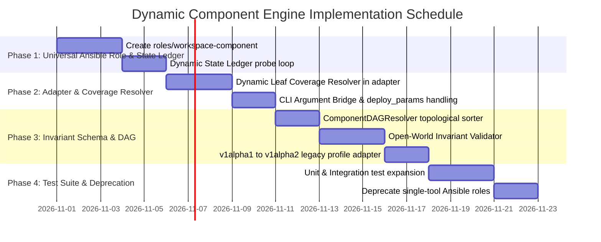

# Dynamic Component Manifest Engine: Open-World Physical AI Stack Architecture

**Status:** Proposed Architecture & Implementation Plan  
**Target Subsystems:**
- Profile Schema & Invariant Validation ([`src/python/workstation_profile.py`](../../../src/python/workstation_profile.py))
- Profile Adapters & Coverage Engine ([`src/python/profile_adapters.py`](../../../src/python/profile_adapters.py))
- CLI Argument Injection & Deployer ([`src/python/deploy_command.py`](../../../src/python/deploy_command.py), [`src/python/deployer.py`](../../../src/python/deployer.py), [`src/ansible/inventory.template`](../../../src/ansible/inventory.template))
- Security-Hardened Universal Component Role ([`src/ansible/roles/workspace-component/`](../../../src/ansible/roles/workspace-component/), [`src/ansible/roles/public-git/`](../../../src/ansible/roles/public-git/))
- Ansible Master Playbook & Tags ([`src/ansible/roles/isaac-workstation/meta/main.yml`](../../../src/ansible/roles/isaac-workstation/meta/main.yml))
- Dynamic State Ledger & Verification Engine ([`src/ansible/roles/state-ledger/tasks/main.yml`](../../../src/ansible/roles/state-ledger/tasks/main.yml))

---

## 1. Executive Summary & Problem Statement

Isaac Automator deploys physical AI workstations capable of running Isaac Sim 6.0.1, Isaac Lab v3, IsaacLab-Arena, Isaac-GR00T, LeRobot, RoboLab, and custom robotics software. However, the system currently suffers from an architectural anti-pattern: **the profile specification and provisioning engine treat components as closed-world static enums rather than an open-world declarative manifest**.

### Current Limitations Identified Across the Codebase
1. **Multi-Layer Hardcoding**: Adding or modifying any repository, benchmark, or model (e.g. `robolab`, custom ROS2 nodes, external VLAs, or laboratory forks) currently requires invasive code changes across at least **7 files**:
   - Closed tuples in [`src/python/workstation_profile.py`](../../../src/python/workstation_profile.py) (`COMPONENTS`, `RUNTIMES`, `COMPONENT_RUNTIME`, `DEPENDENCIES`).
   - Constant dictionaries, loop tuples, and hardcoded flag blocks in [`src/python/profile_adapters.py`](../../../src/python/profile_adapters.py) (`REPO_DIRS`, `LEGACY_NAMES`, `install_gr00t`, `install_robolab`).
   - Click command line argument mapping in [`src/python/deploy_command.py`](../../../src/python/deploy_command.py) (`_APP_NAMES`, `deploy_params`).
   - Inventory variable templating in [`src/python/deployer.py`](../../../src/python/deployer.py) and [`src/ansible/inventory.template`](../../../src/ansible/inventory.template).
   - Boilerplate Ansible roles created for each single repository (`roles/robolab`, `roles/lerobot`, `roles/gr00t`, etc.).
   - Static dependency list in [`src/ansible/roles/isaac-workstation/meta/main.yml`](../../../src/ansible/roles/isaac-workstation/meta/main.yml).
   - Hardcoded discrete probe tasks and rigid JSON templating in [`src/ansible/roles/state-ledger/tasks/main.yml`](../../../src/ansible/roles/state-ledger/tasks/main.yml).
2. **Developer & Operator Friction**: Operators cannot test alternative forks, custom robotics repositories, or new foundation models simply by declaring them in their YAML profile. The profile validator rejects unexpected component keys before provisioning even starts.
3. **Ansible Role Proliferation & Playbook Overhead**: Every new tool duplicates 80% of git clone/remote configuration and pip installation tasks, inflating maintenance overhead and slowing playbook execution.

### The Objective
Migrate Isaac Automator to an **Open-World, Manifest-Driven Component Engine**. Operators must be empowered to declare arbitrary repositories, git references, dual-remote tracking (fork + upstream), environment bindings (pip, conda, uv, script), and desktop launchers **entirely within their YAML profile (`configs/workstations/*.yaml`) without writing or modifying a single line of Python or Ansible code**.

---

## 2. Core Architectural Invariants

| Principle | Old Closed-World Architecture | Target Open-World Architecture |
| :--- | :--- | :--- |
| **Component Extensibility** | Hardcoded tuple `('sim', 'lab', 'arena', 'gr00t', 'lerobot', 'robolab')` | Manifest-driven: arbitrary component IDs declared in YAML list. |
| **Schema Validation** | Strict key-identity matching. Any unknown key raises `ProfileError`. | Invariant-based validation: validates HTTPS URLs, valid git refs, directory paths, and runtime target existence. |
| **Dependency Resolution** | Static dictionary `DEPENDENCIES` hardcoded in Python. | Manifest-declared `dependencies: [lab]`, resolved into a topological DAG. |
| **Ansible Orchestration** | Monolithic sequence of discrete per-tool roles (`roles/robolab`, `roles/lerobot`, etc.). | Universal parameterized role (`roles/workspace-component/`) dynamically iterating over `profile_components`. |
| **Security Boundaries** | Ad-hoc git cloning per role. | Reuses `roles/public-git` and `public_git.py`: strict HTTPS protocol, no credential leakage, bounded file sizes, and isolated git environment. |
| **Coverage & Compiling** | Static leaf-by-leaf `mark()` calls in `profile_adapters.py`. | Dynamic Leaf Coverage Resolver: automatically marks validated component subtrees to satisfy `render_supported`. |
| **CLI Transport Bridge** | Click options tightly coupled to specific components. | `deploy_params` bridges legacy CLI options (`isaacsim`, `isaaclab`, `isaaclab_arena`) while open-world components bypass Click via inventory extra vars. |
| **Audit Ledger** | Hardcoded discrete git probe shell tasks and rigid JSON template in `state-ledger`. | Dynamic ledger engine looping over resolved components and generating immutable audit receipt. |
| **Backward Compatibility** | N/A (breaking change risk). | 100% backward compatible: legacy `v1alpha1` dictionary profiles are seamlessly converted into normalized component manifests. |

---

## 3. High-Level Architecture & Lifecycle Flow

```mermaid
flowchart TD
    ProfileYAML["Workstation Profile YAML\n(configs/workstations/*.yaml)"] --> Parser["Profile Parser & Invariant Validator\n(src/python/workstation_profile.py)"]
    
    subgraph Python Engine
        Parser --> InvariantCheck{"Validates Structural Invariants:\n- Safe HTTPS / Git URLs\n- Alphanumeric ID & Safe Paths\n- Declared Runtime Exists"}
        InvariantCheck --> DAG["Topological Sorter (DAG):\nResolves dependency order\n(sim -> lab -> arena / robolab)"]
        DAG --> Adapter["Profile Adapter\n(src/python/profile_adapters.py)"]
        Adapter --> Coverage["Dynamic Leaf Coverage Resolver:\nMarks component subtrees as mapped\nSatisfies render_supported: True"]
        Coverage --> CLIBridge["CLI Argument Bridge:\nSupplies legacy deploy_params\nSerializes profile_components JSON"]
    end

    subgraph Ansible Provisioning
        CLIBridge --> Inventory["deployer.py / inventory vars:\n[isaac_workstation:vars]\nprofile_components: [...]"]
        Inventory --> Playbook["Master Playbook (isaac-workstation)"]
        Playbook --> UniversalRole["Universal Component Role\n(roles/workspace-component)"]
        
        UniversalRole --> LoopComponents{"Dynamic Loop over\nprofile_components"}
        LoopComponents --> SecureGit["1. Security-Hardened Checkout\n(public-git / public_git.py)\nConfigures origin + upstream remotes"]
        SecureGit --> RuntimeDispatch["2. Runtime Dispatch & Install\nconda: /usr/local/bin/isaaclab-env pip -e .\nuv: uv pip install -e .\nscript: bash ./setup.sh"]
        RuntimeDispatch --> DesktopTask["3. Optional Desktop Shortcut Launcher"]
    end

    subgraph Dynamic Verification & Audit
        DesktopTask --> Ledger["Dynamic State Ledger\n(roles/state-ledger)"]
        Ledger --> ProbeLoop["Loop over profile_components:\nQuery HEAD commit SHA & active branch"]
        ProbeLoop --> OutputReceipt["Writes immutable audit ledger:\n/etc/isaac_workstation/state_ledger.json"]
    end
```



---

## 4. Detailed Technical Specification & Code Architecture

### 4.1. Manifest Specification (`schema_version: v1alpha2`)

The new profile specification introduces a declarative `components` list and flexible `runtimes` definition:

```yaml
schema_version: v1alpha2
kind: workstation-profile
name: boredengineering-dev

workspace:
  root: ~/Documents/GitHub
  name: BoredEngineer

# Declared execution environments on the workstation
runtimes:
  kit:
    manager: bundled
    environment: kit
  lab:
    manager: conda
    environment: isaaclab
    python: "3.12"
    torch: "2.10.0+cu128"
  gr00t:
    manager: uv
    environment: gr00t
  lerobot:
    manager: conda
    environment: lerobot
    python: "3.10"

# Open-world components: arbitrary repositories, benchmarks, models, and tools
components:
  - id: sim
    type: standalone
    runtime: kit
    url: https://downloads.isaacsim.nvidia.com/isaac-sim-standalone-6.0.1-linux-x86_64.zip
    sha256: 348013c4d3ac398d40162566d0edfe4f3837a0eb5efa358ec87065f81aa68dd7
    install_dir: ~/IsaacSim

  - id: lab
    type: git
    runtime: lab
    repository: https://github.com/boredengineering/IsaacLab.git
    ref: dev/arena_v0.3.0-compat
    upstream: https://github.com/isaac-sim/IsaacLab.git
    install:
      method: editable
    dependencies: [sim]

  - id: arena
    type: git
    runtime: lab
    repository: https://github.com/boredengineering/IsaacLab-Arena.git
    ref: dev/0.3.0-prerelease
    upstream: https://github.com/isaac-sim/IsaacLab-Arena.git
    install:
      method: editable
    dependencies: [lab]

  - id: robolab
    type: git
    runtime: lab
    repository: https://github.com/boredengineering/RoboLab.git
    ref: main
    upstream: https://github.com/NVlabs/RoboLab.git
    install:
      method: editable
    dependencies: [lab]
    desktop_shortcut:
      name: RoboLab Dashboard
      exec: "/usr/local/bin/isaaclab-env python -m dashboard.cli"
      icon: "utilities-terminal"

  - id: custom_research_vla
    type: git
    runtime: lab
    repository: https://github.com/user/custom-vla-teleop.git
    ref: feature/h1-control
    dependencies: [lab]
    install:
      method: script
      command: "./setup.sh --cuda"
```

---

### 4.2. Topological Dependency Ordering & DAG Resolution ([`src/python/workstation_profile.py`](../../../src/python/workstation_profile.py))

Components can depend on other components (e.g. `arena` and `robolab` depend on `lab`, which depends on `sim`). To prevent installation order failures regardless of declaration order in the YAML profile, the parser sorts components using a topological sort algorithm:

```python
class ComponentDAGResolver:
    """Sorts components into strict dependency order using Kahn's topological sort."""
    
    @staticmethod
    def resolve_order(components: list[dict]) -> list[dict]:
        comp_map = {c['id']: c for c in components}
        in_degree = {c['id']: 0 for c in components}
        graph = {c['id']: [] for c in components}
        
        for c in components:
            deps = c.get('dependencies', [])
            for dep in deps:
                if dep not in comp_map:
                    raise ProfileError(f"Component '{c['id']}' depends on undeclared component '{dep}'")
                graph[dep].append(c['id'])
                in_degree[c['id']] += 1
        
        queue = [cid for cid, deg in in_degree.items() if deg == 0]
        sorted_ids = []
        
        while queue:
            curr = queue.pop(0)
            sorted_ids.append(curr)
            for neighbor in graph[curr]:
                in_degree[neighbor] -= 1
                if in_degree[neighbor] == 0:
                    queue.append(neighbor)
        
        if len(sorted_ids) != len(components):
            cycle_nodes = [cid for cid, deg in in_degree.items() if deg > 0]
            raise ProfileError(f"Circular dependency detected between components: {cycle_nodes}")
            
        return [comp_map[cid] for cid in sorted_ids]
```

---

### 4.3. Invariant-Based Open-World Validation ([`src/python/workstation_profile.py`](../../../src/python/workstation_profile.py))

Instead of testing `component_name in COMPONENTS`, the validator checks structural safety and security constraints:

```python
class ComponentSpec:
    """Validates structural invariants of open-world components."""

    @staticmethod
    def validate(comp: dict, valid_runtimes: set[str], seen_ids: set[str]):
        # 1. Identifier safety (alphanumeric, dashes, underscores only)
        comp_id = comp.get("id")
        if not comp_id or not re.fullmatch(r"[a-z0-9][a-z0-9_-]{0,63}", comp_id):
            raise ProfileError(f"Invalid component id '{comp_id}': must be lowercase alphanumeric/dashes")
        if comp_id in seen_ids:
            raise ProfileError(f"Duplicate component id '{comp_id}' in profile")
        seen_ids.add(comp_id)

        # 2. Runtime linkage
        runtime = comp.get("runtime")
        if not runtime or runtime not in valid_runtimes:
            raise ProfileError(f"Component '{comp_id}' specifies undeclared runtime '{runtime}'")

        # 3. Source repository validation
        comp_type = comp.get("type", "git")
        if comp_type == "git":
            repo = comp.get("repository")
            if not repo or not re.fullmatch(r"https://[A-Za-z0-9_.-]+/[A-Za-z0-9_.-]+/[A-Za-z0-9_.-]+\.git", repo):
                raise ProfileError(f"Component '{comp_id}': repository must be a valid HTTPS Git URL ending in .git")
            
            ref = comp.get("ref")
            if not ref or ".." in ref or any(p.startswith(".") or p.endswith(".lock") for p in ref.split("/")):
                raise ProfileError(f"Component '{comp_id}': invalid git ref '{ref}'")

            upstream = comp.get("upstream")
            if upstream and not re.fullmatch(r"https://[A-Za-z0-9_.-]+/[A-Za-z0-9_.-]+/[A-Za-z0-9_.-]+\.git", upstream):
                raise ProfileError(f"Component '{comp_id}': upstream must be a valid HTTPS Git URL")
        elif comp_type == "standalone":
            url = comp.get("url")
            if not url or not url.startswith("https://"):
                raise ProfileError(f"Component '{comp_id}': standalone url must be HTTPS")
        else:
            raise ProfileError(f"Component '{comp_id}': unsupported component type '{comp_type}'")

        # 4. Installation method validation
        install = comp.get("install", {})
        method = install.get("method", "editable")
        if method not in ("editable", "standard", "script", "none"):
            raise ProfileError(f"Component '{comp_id}': unsupported install method '{method}'")
        if method == "script" and not install.get("command"):
            raise ProfileError(f"Component '{comp_id}': script install requires 'command'")
```

---

### 4.4. Dynamic Leaf Coverage & Adapter Translation ([`src/python/profile_adapters.py`](../../../src/python/profile_adapters.py))

#### The Problem: Coverage Blocker Engine
`render_profile` is a coverage-enforced compiler: every leaf in the profile dictionary is tracked in `coverage`. If any leaf is left unmarked or marked `'unsupported'`, `blockers` is non-empty, `render_supported` becomes `False`, and provisioning halts.

#### The Solution: Dynamic Leaf Coverage Resolver
The adapter must dynamically resolve each declared component and mark its structural leaves as `mapped` to `workspace-component`:

```python
def _resolve_dynamic_components(profile: dict, home: str, coverage: dict, mark_fn, subtree_fn):
    """Dynamically parses and marks open-world components for Ansible extra vars."""
    raw_components = profile.get("components", [])
    if isinstance(raw_components, dict):
        # Backward compatibility: Convert v1alpha1 dict into v1alpha2 list
        raw_components = _convert_legacy_components_dict(raw_components)

    # Sort in dependency DAG order
    ordered_components = ComponentDAGResolver.resolve_order(raw_components)
    components_payload = []
    workspace_root = profile.get("workspace", {}).get("root", "~/Documents/GitHub")
    workspace_name = profile.get("workspace", {}).get("name", "BoredEngineer")
    resolved_ws_dir = home + "/" + workspace_root.lstrip("~/") + "/" + workspace_name

    for comp in ordered_components:
        comp_id = comp["id"]
        path = f"components.{comp_id}"
        comp_type = comp.get("type", "git")
        dest_dir = comp.get("install_dir") or f"{resolved_ws_dir}/{comp.get('dir_name', comp_id.capitalize())}"
        
        comp_dict = {
            "id": comp_id,
            "type": comp_type,
            "runtime": comp.get("runtime", "lab"),
            "dest": dest_dir,
            "repository": comp.get("repository"),
            "ref": comp.get("ref"),
            "upstream": comp.get("upstream"),
            "install_method": comp.get("install", {}).get("method", "editable"),
            "install_command": comp.get("install", {}).get("command"),
            "desktop_shortcut": comp.get("desktop_shortcut"),
            "dependencies": comp.get("dependencies", []),
        }
        components_payload.append(comp_dict)

        # Satisfy coverage compiler dynamically:
        subtree_fn(path, "mapped", consumer="workspace-component")

    return components_payload
```

#### CLI Argument Injection Bridge
`DeployCommand.parse_args` inspects `report['deploy_params']`. To prevent Click from triggering legacy interactive prompts for Isaac Sim/Lab/Arena while avoiding `no such option: --robolab` errors for open-world components:
1. `deploy_params` continues to emit values for the 3 legacy apps (`isaacsim`, `isaaclab`, `isaaclab_arena`) if present in `components`.
2. All dynamic components bypass Click flags completely and are serialized into the Ansible inventory vars as `profile_components` and `profile_components_json`.

#### Multi-Adapter Parity (`ansible`, `packer`, `local`)
- When `adapter == 'ansible'` or `adapter == 'packer'`: `artifact['profile_components']` contains the full list of dynamic component specifications.
- When `adapter == 'local'` (bare-metal physical installer): `artifact['repositories']` is populated with corresponding repository definitions to maintain 100% compatibility with local installer action plans.

---

### 4.5. Security-Hardened Universal Ansible Role ([`src/ansible/roles/workspace-component/`](../../../src/ansible/roles/workspace-component/))

A single, parameterized, idempotent role replaces the sprawling single-tool roles (`roles/robolab`, `roles/lerobot`, `roles/isaaclab-arena-source`).

#### 1. Security Invariant: Integration with `roles/public-git`
Rather than calling unconstrained `git clone`, the role invokes `roles/public-git/tasks/source.yml` (and `/usr/local/lib/isaac-automator/public_git.py`) to guarantee HTTPS-only protocol, clean environments without hook execution, and exact ref verification.

#### 2. Task Layout (`roles/workspace-component/tasks/`)
- `main.yml`: Iterates over `profile_components`.
- `git.yml`: Executes secure checkout and dual-remote configuration.
- `install.yml`: Executes environment binding and installation based on declared runtime manager.
- `desktop.yml`: Generates desktop shortcut if declared.

```yaml
# src/ansible/roles/workspace-component/tasks/main.yml
---
- name: Process workspace components
  ansible.builtin.include_tasks: component.yml
  loop: "{{ profile_components | default([]) }}"
  loop_control:
    loop_var: current_component
  when: current_component.type | default('git') == 'git'
```

```yaml
# src/ansible/roles/workspace-component/tasks/git.yml
---
- name: "Create destination parent directory for {{ current_component.id }}"
  ansible.builtin.file:
    path: "{{ current_component.dest | dirname }}"
    state: directory
    owner: "{{ ansible_user }}"
    group: "{{ ansible_user }}"
    mode: '0755'

- name: "Securely check out {{ current_component.id }} via public-git"
  ansible.builtin.include_tasks: "{{ playbook_dir }}/roles/public-git/tasks/source.yml"
  vars:
    public_git_repository: "{{ current_component.repository }}"
    public_git_ref: "{{ current_component.ref }}"
    public_git_destination: "{{ current_component.dest }}"
    public_git_allow_submodules: true

- name: "Configure upstream tracking remote for {{ current_component.id }}"
  community.general.git_config:
    name: remote.upstream.url
    value: "{{ current_component.upstream }}"
    repo: "{{ current_component.dest }}"
    scope: local
  become_user: "{{ ansible_user }}"
  when: current_component.upstream is defined and current_component.upstream | length > 0
```

```yaml
# src/ansible/roles/workspace-component/tasks/install.yml
---
- name: "Install {{ current_component.id }} in editable mode"
  when: current_component.install_method == 'editable'
  block:
    - name: "Run editable pip install inside isaaclab conda environment"
      ansible.builtin.shell: >
        /usr/local/bin/isaaclab-env pip install -e . 2>&1 | tee /tmp/install-{{ current_component.id }}.log
      args:
        chdir: "{{ current_component.dest }}"
      become_user: "{{ ansible_user }}"
      when: current_component.runtime == 'lab'

    - name: "Run editable pip install inside uv virtual environment"
      ansible.builtin.shell: >
        /usr/local/bin/uv pip install -e . 2>&1 | tee /tmp/install-{{ current_component.id }}.log
      args:
        chdir: "{{ current_component.dest }}"
      become_user: "{{ ansible_user }}"
      when: current_component.runtime == 'gr00t'

- name: "Execute custom script install for {{ current_component.id }}"
  ansible.builtin.shell: "{{ current_component.install_command }}"
  args:
    chdir: "{{ current_component.dest }}"
  become_user: "{{ ansible_user }}"
  when: current_component.install_method == 'script' and current_component.install_command is defined
```

```yaml
# src/ansible/roles/workspace-component/tasks/desktop.yml
---
- name: "Deploy Desktop shortcut for {{ current_component.id }}"
  when: current_component.desktop_shortcut is defined
  block:
    - name: "Render .desktop launcher file"
      ansible.builtin.copy:
        dest: "/home/{{ ansible_user }}/Desktop/{{ current_component.desktop_shortcut.name | regex_replace('[^a-zA-Z0-9_-]', '-') }}.desktop"
        content: |
          [Desktop Entry]
          Type=Application
          Name={{ current_component.desktop_shortcut.name }}
          Exec=gnome-terminal -- /bin/bash -c "cd {{ current_component.dest }} && {{ current_component.desktop_shortcut.exec }}; exec bash"
          Icon={{ current_component.desktop_shortcut.icon | default('utilities-terminal') }}
          Terminal=true
          Categories=Development;Engineering;
        owner: "{{ ansible_user }}"
        group: "{{ ansible_user }}"
        mode: '0755'

    - name: "Trust desktop launcher via gio"
      ansible.builtin.command:
        cmd: gio set "/home/{{ ansible_user }}/Desktop/{{ current_component.desktop_shortcut.name | regex_replace('[^a-zA-Z0-9_-]', '-') }}.desktop" metadata::trusted true
      become_user: "{{ ansible_user }}"
      ignore_errors: true
```

---

### 4.6. Dynamic State Ledger Engine ([`src/ansible/roles/state-ledger/`](../../../src/ansible/roles/state-ledger/))

Instead of brittle per-component `find` commands, the state ledger queries Git commit HEADs dynamically across `profile_components`:

```yaml
# src/ansible/roles/state-ledger/tasks/main.yml
---
- name: Query Git HEAD commit for all installed components
  ansible.builtin.command:
    cmd: git rev-parse HEAD
    chdir: "{{ item.dest }}"
  register: component_git_commits
  loop: "{{ profile_components | default([]) }}"
  when: item.type | default('git') == 'git'
  changed_when: false
  failed_when: false

- name: Assemble dynamic component ledger dictionary
  ansible.builtin.set_fact:
    dynamic_ledger_components: >-
      {{
        dynamic_ledger_components | default({}) | combine({
          item.item.id: {
            'dest': item.item.dest,
            'repository': item.item.repository,
            'ref': item.item.ref,
            'commit': (item.stdout | trim) if (item.rc is defined and item.rc == 0) else 'unreachable',
            'upstream': item.item.upstream | default(none),
            'runtime': item.item.runtime | default('lab')
          }
        })
      }}
  loop: "{{ component_git_commits.results | default([]) }}"
  when: item.skipped is not defined

- name: Write unified software state ledger receipt
  ansible.builtin.copy:
    dest: /etc/isaac_workstation/state_ledger.json
    content: >-
      {{
        {
          'timestamp': ansible_date_time.iso8601,
          'profile_name': profile_name | default('unknown'),
          'components': dynamic_ledger_components | default({})
        } | to_nice_json
      }}
    owner: root
    group: root
    mode: '0644'
```

---

## 5. Workstreams & Phased Implementation Plan



### Milestone 1: Universal Ansible Component Role & Dynamic State Ledger
- **Target Files**:
  - `src/ansible/roles/workspace-component/tasks/{main.yml,component.yml,git.yml,install.yml,desktop.yml}`
  - `src/ansible/roles/workspace-component/defaults/main.yml`
  - `src/ansible/roles/workspace-component/meta/main.yml`
  - `src/ansible/roles/state-ledger/tasks/main.yml`
  - `src/ansible/roles/isaac-workstation/meta/main.yml`
- **Concrete Code Modifications**:
  - Implement parameterized role calling `roles/public-git/tasks/source.yml` for secure fetching.
  - Implement runtime dispatch for conda (`/usr/local/bin/isaaclab-env`) and uv (`/usr/local/bin/uv`).
  - Wire `workspace-component` into `isaac-workstation/meta/main.yml` with tag `tags: ['__workspace_components']`.
  - Refactor `state-ledger` to loop dynamically over `profile_components`.

### Milestone 2: Dynamic Profile Adapter & Inventory Payload
- **Target Files**:
  - `src/python/profile_adapters.py`
  - `src/python/deploy_command.py`
  - `src/python/deployer.py`
- **Concrete Code Modifications**:
  - Implement `_resolve_dynamic_components()` in `profile_adapters.py`.
  - Implement the **Dynamic Leaf Coverage Resolver** to dynamically mark component leaves as mapped.
  - Populate `artifact["profile_components"]` and serialize `artifact["profile_components_json"]`.
  - Preserve `deploy_params` for legacy options (`isaacsim`, `isaaclab`, `isaaclab_arena`) while omitting dynamic components from CLI flags.

### Milestone 3: Open-World Manifest Schema & Topological DAG Resolution
- **Target Files**:
  - `src/python/workstation_profile.py`
  - `configs/workstations/boredengineering-dev.yaml`
  - `configs/workstations/studio-enterprise.yaml`
- **Concrete Code Modifications**:
  - Implement `ComponentDAGResolver` for dependency sorting and cycle detection.
  - Replace closed tuples (`COMPONENTS = (...)`, `RUNTIMES = (...)`) with open-world `ComponentSpec.validate()`.
  - Implement `_convert_legacy_components_dict` to seamlessly adapt `v1alpha1` profiles to `v1alpha2`.

### Milestone 4: Verification, Test Protocol & Deprecation
- **Target Files**:
  - `src/tests/workstation_profile.test.py`
  - `src/tests/profile_adapters.test.py`
  - `src/tests/dynamic_components.test.py`
- **Concrete Code Modifications**:
  - Add test suites for:
    - Arbitrary repository names and URLs.
    - Topological DAG ordering (`sim -> lab -> arena -> robolab`).
    - Circular dependency rejection.
    - Unsafe URL and path traversal rejection.
    - Full end-to-end simulation of inventory generation.
  - Deprecate single-tool roles (`roles/robolab`, `roles/lerobot`, `roles/gr00t`).

---

## 6. Backward Compatibility & Migration Strategy

1. **Automatic Schema Adaptation**:
   - Profiles declaring `schema_version: v1alpha1` or omitting the version are automatically normalized in-memory by `_convert_legacy_components_dict()`:
     ```python
     # Legacy dictionary syntax:
     components:
       robolab:
         enabled: true
         source: { repository: "...", ref: "main" }
     # Automatically converted to internal v1alpha2 representation:
     components:
       - id: "robolab"
         type: "git"
         repository: "..."
         ref: "main"
     ```
2. **Legacy Flag Bridges**:
   - `profile_adapters.py` continues emitting legacy boolean variables (`install_robolab: true`, `install_gr00t: true`) during the deprecation window so older roles or playbooks continue functioning without disruption.
3. **Preserved CLI Workflows**:
   - All standard top-level operator commands (`./deploy-gcp`, `./deploy-aws`, `./start`, `--existing run_ansible`) remain completely unchanged.

---

## 7. Acceptance Criteria & Quality Gates

1. **Zero-Code Repository Addition**:
   - An operator can add an arbitrary physical AI repository (e.g. `https://github.com/huggingface/lerobot.git` or `https://github.com/open-teleop/teleop.git`) directly to `configs/workstations/boredengineering-dev.yaml` under `components:`.
   - Running `./deploy-gcp --existing run_ansible` clones the repository securely via `public-git`, installs it under the specified runtime environment, and logs the HEAD commit in `/etc/isaac_workstation/state_ledger.json`.
   - **Zero Python or Ansible code changes required.**
2. **Complete Test Suite Success**:
   - 100% pass rate across all existing unit test suites (`src/tests/*.py`).
   - New unit tests in `src/tests/dynamic_components.test.py` confirm:
     - DAG sorting order.
     - Security validation against path traversal and protocol injection.
     - Coverage compiler pass (`render_supported: True`).
3. **Audit Ledger Verification**:
   - The verified `/etc/isaac_workstation/state_ledger.json` receipt dynamically includes all declared components with their verified Git commit hashes.
